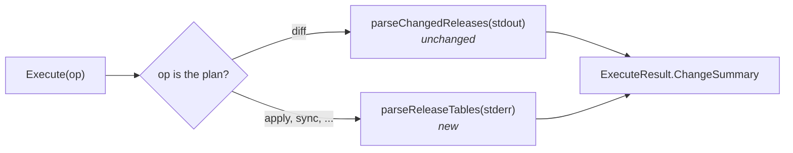

# Design: What a Mutating Command Changed (Slice 47)

## Overview

Two parts:

1. **Helmfile counts its mutating commands**: one parser in
   `internal/plugin`, called from `HelmfilePlugin.Execute` for every
   Mutating_Operation, reading Helmfile's own summary tables from
   **stderr**, from Helmfile v1.6.0 on. The comment and the Project_Check Title already render
   whatever counts an `ExecuteResult` carries, as the plan's `+0 ~3 -0`
   shows.
2. **Each Plugin says, per run, whether its counts mean anything**
   (Requirement 5), and a mutating command whose counts do not renders
   "succeeded" rather than "no changes". Helmfile uses it for output from
   versions before v1.6.0.



The branch is on "not the plan", not on a list of names, so a
Mutating_Operation the Plugin gains later is counted without an edit
(the same exclusion Slice 20 uses everywhere).

## What Helmfile prints

Read from Helmfile's source (`DisplayAffectedReleases`,
`pkg/state/state.go`), not inferred from one run's output:

Every version writes the tables to **stderr**, through Helmfile's logger,
and every table's body is a header row (`NAME …`) then one row per
release, logged as one message, so a blank line follows it. The banner
is what changed:

| Helmfile | Banner | Counted |
|---|---|---|
| up to v1.5.x | `UPDATED RELEASES:` (and `REINSTALLED RELEASES:` from v1.4.0) | no: rendered "succeeded" |
| v1.6.0 – v1.7.2 | `========== Updated Releases ==========` | yes |
| v1.7.3 on (v1.8.1 at writing) | `==== Updated Releases ====`, centered on the table; a fixed frame when the table is narrower than the title | yes |

The framed banner is bold blue unless color is off. The tables are
Updated, Reinstalled (v1.4.0 on; a reinstalled release is listed only
there, not also as updated), Deleted, Failed and Failed to Delete.

Each sub-helmfile prints its own tables when it finishes, so one run
carries a set of tables per sub-helmfile that changed something.

## Parsing

| Step | Rule |
|---|---|
| Input | the stderr text of the run, with ANSI color sequences (`ESC [ … m`) removed first |
| Banner | a line that, trimmed, is `=`… *title* …`=`, whatever the title |
| Title → count | Updated, Reinstalled: changed. Deleted: destroyed. Any other title (Failed, Failed to Delete): skipped, not counted |
| Rows | after a banner, the first non-blank line is the header row and is skipped; each following non-blank line is one release; a blank line, or another banner, ends the table |
| Result | summed over every table: `Change` and `Destroy`; `Add` stays zero (Requirement 1.3) |

The failed tables need no entry of their own. A table's rows end at the
next banner of any title, known or not, so a failed table's rows are
never read as the body of the table before it even if the blank line
between them were missing, and an unknown title's rows are skipped. A
failure therefore never inflates the count of an Operation that is
rendered as failed anyway (Requirement 3).

### Decision 1: stderr only

*Alternative considered*: parse the whole transcript, both streams.

*Rejected because*: stdout carries the diffs Helmfile prints before it
upgrades anything, and a diff is arbitrary manifest content. A ConfigMap
whose data holds the text `UPDATED RELEASES:` would open a table that
counts whatever follows. The plan's parser reads stdout only for the
mirror-image reason (Helmfile's progress on stderr would read as diff
bodies). Each parser reads the one stream its signal is on.

### Decision 2: Count from v1.6.0; older output reads "succeeded"

*Alternative considered*: parse the older `UPDATED RELEASES:` banner as
well, so every version counts.

*Rejected because* (decided 2026-09-30): it grows the parser, and its
fixtures, for versions nobody should start on, and each future format
change would add another. The older format is instead only *recognized*,
by the Server, to say its counts cannot be read (next section). Which
Helmfile ran cannot be told from `uses:`: a custom image, `latest` or a
digest says nothing about the version inside, so the output is the only
reliable signal.

**What a future format change does**: an unrecognized banner counts
nothing, so the result degrades to "no changes" until the parser learns
it. The fixtures pin the framed banner, so a change to it fails a test
rather than shipping.

## A Plugin that does not count

The Plugin interface gains one method:

```go
// MutationChangesReported reports whether a successful Mutating_Operation's
// counts are meaningful, given its transcript. False renders "succeeded".
MutationChangesReported(output string) bool
```

| Plugin | Returns |
|---|---|
| Helmfile | false when the transcript carries an older banner (`UPDATED RELEASES:`, `REINSTALLED RELEASES:`, `DELETED RELEASES:`, `FAILED RELEASES:`, `FAILED TO DELETE RELEASES:`), or when turnip's argv annotation shows Helmfile's log level set above info (`-q`, `--quiet`, `--log-level warn` and up, unless `--debug`), since the tables are logged at info; true otherwise |
| Terraform, Pulumi (Slice 7) | false, always: each applies a saved plan the plan's counts already described |
| test fakes | true, which keeps every existing rendering test as it is |

**Where it is read**: in the Server, when a mutating Operation's result is
turned into the `ProjectResult` the comment and the check are built from,
with the transcript the Runner already sends (`OperationResult.Output`).
The Server holds every Plugin (Slice 45's registry), so the Runner, the
gRPC result and the proto are untouched (Requirement 5.5).

**The transcript mixes both streams**, so the older banner's text inside
a stdout diff (a ConfigMap holding it) would make a current run render
"succeeded" instead of its counts. Accepted: it can only hide a count,
never invent one. The counting stays on the Runner, where the streams
are apart.

**How "unreported" travels**: `github.ChangeCounts` gains `Unreported
bool`. Its zero value is false, so every count built today, a plan's
included, still means what it means (Requirement 5.4). Putting it on the
counts rather than beside them means every renderer that already takes
the counts sees it, so no rendering site can miss it:

| Where | Counted, zero | Unreported |
|---|---|---|
| summary line (`ChangeText`) | `web: apply, no changes` | `web: apply, succeeded` |
| Project_Check Title (`completedTitle`) | `no changes` | `succeeded` |
| single-Project headline | **No changes in `web`.** | **Succeeded in `web`.** |
| multi-Project headline | "No changes across 3 projects", or "N with no changes" as a note | "Succeeded across 3 projects", or "N succeeded" as a note |

A failed Operation still renders as failed, whatever the flag
(Requirement 3). The `turnip` check's verdict is untouched: it follows
Lock events, never counts.

### Decision 3: A Plugin method, not a field on the result

*Alternative considered*: a flag on `ExecuteResult`, carried from the
Runner to the Server in the gRPC result.

*Rejected because*: the Server already has both things the answer needs,
the Plugin and the transcript, so it can ask directly. A result field
would change the proto, and its regenerated output, to carry a value the
Server can compute.

## Testing

- **Fixtures**, as stderr text in Helmfile's real format with placeholder
  names (`web`, `api`, `example.com` charts), each asserting the
  `ChangeSummary`:
  - one updated table; several (two sub-helmfiles); a deleted table; a
    reinstalled table; a failed table beside an updated one, counting
    only the updated rows; no table
  - the framed banner with and without color, in both widths (fixed,
    v1.6.0 – v1.7.2, and centered); the older `UPDATED RELEASES:` banner
    counts nothing
  - a release whose diff was "empty after suppression" on stdout and that
    appears in stderr's updated table: counted once
  - the table banner's text inside a stdout diff body: not counted
- **`Execute`**, through the Plugin's existing command-runner seam: an
  `apply` and a `sync` return the tables' counts; a `diff` still counts
  from stdout as before.
- **End to end**: a successful apply's `+0 ~3 -0` reaches the comment's
  summary line and the Project_Check Title (Requirement 4.3), through the
  orchestrator's result handling rather than a hand-built comment.
- **`MutationChangesReported`** for Helmfile: an older-format
  transcript returns false and renders "succeeded"; a current one
  returns true; a current one whose stdout diff holds the older banner's
  text returns false (the accepted trade-off, pinned).
- **Unreported**: with a fake Plugin returning false, a successful apply
  renders "succeeded" in the summary line, the headline and the Title,
  and never "no changes"; its plan still renders its counts; a failed
  apply still renders as failed. Each renderer's table row is asserted,
  single-Project and multi-Project.
