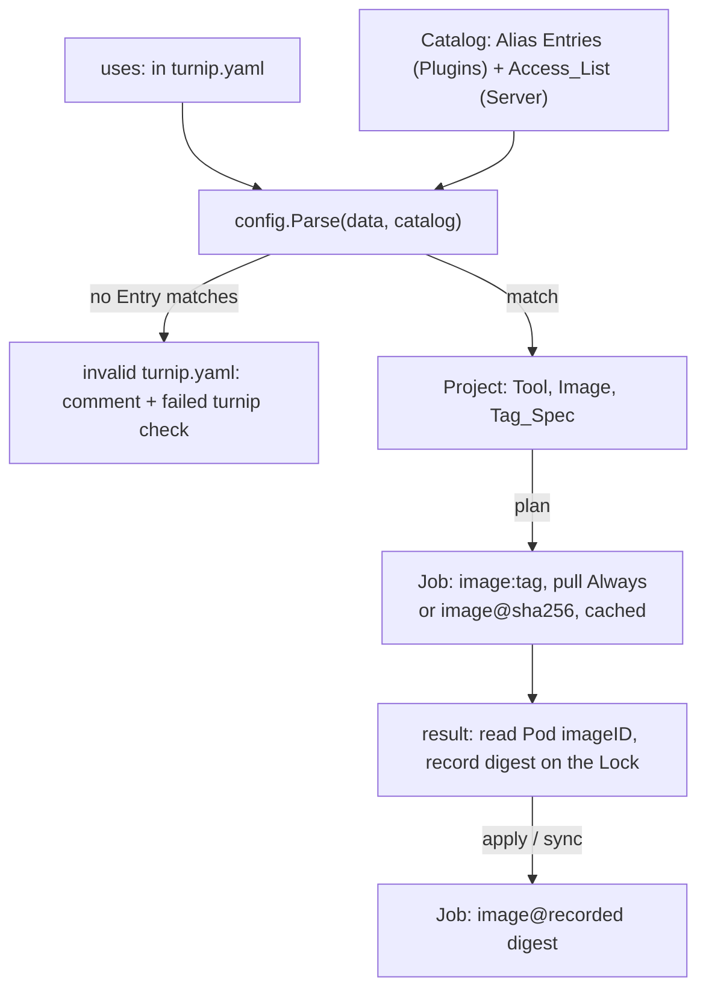

# Design: Running a Tool Image the Operator Approves (Slice 44)

## Overview

Four pieces, in the order a `uses:` line meets them:

1. **Resolving `uses:`** into a tool, an image and a Tag_Spec, at parse
   time, against the Entries this Server allows: each Plugin's Alias plus
   the operator's Access_List.
2. **Building the Job** from an image reference the orchestrator composes,
   with a pull policy that follows the Tag_Spec.
3. **Recording the plan's digest** on the Lock, and running it for every
   Mutating_Operation.
4. **`SECURITY.md`** and the documentation.



## Reconciling two requirements with Slice 45

**Requirement 4.6 says an unallowed image is a configuration refusal
(Slice 36): a failed Project_Check. This design makes it a validation
error of `turnip.yaml` instead.** Requirement 4.6 predates Slice 45, which
made a tool with no Plugin a validation error rather than a refusal. An
image the Server does not allow is the same kind of problem — the file asks
this Server for something it will not run — and resolving `uses:` needs the
Entries anyway, so the answer is known when the file is parsed. One path,
consistent with Slice 45: reported on the pull request in one pass with
every other violation, and the `turnip` check failed as an invalid
`turnip.yaml` (Slice 37, Requirement 7.1). The refusal path would need a
second resolution in the orchestrator for no gain. Requirement 4.6 is to be
amended to match.

**Requirement 4.5 asks the Server to refuse two Entries "that could match
the same image and Tag_Spec for different tools". Whether two globs can
match a common string is not a check worth writing; this design refuses
the same image listed for two different tools at all**, whatever the
globs. It is stricter, decidable in one pass over the Entries, and loses
nothing real: an image that runs two different tools depending on its tag
is not a case anyone has raised.

## Where each fact lives

| Fact | Declared by | Type |
|---|---|---|
| The Alias's image repository | the Plugin | `provisioning.Spec.Image` (Slice 45) |
| The Alias's allowed Tag_Specs | the Plugin | new `ImageTags() []string` on the Plugin interface, globs |
| The Access_List | the operator | `TURNIP_ALLOWED_IMAGES`, parsed at Server start |
| Both, merged | the Server at start | a **Catalog** of Entries, passed to `config.Parse` |

`config.Parse(data []byte, tools []string)` becomes
`config.Parse(data []byte, catalog Catalog)`. The Catalog is plain data —
Entries and the registered Tool_Names — declared in `internal/config`, so
the package still depends on no Plugin. It replaces the `tools` slice
rather than joining it, since the Tool_Names are part of it (design
Decision 3 of Slice 45 anticipated exactly this).

```go
// Entry allows one image, for one tool, with the Tag_Specs its glob matches.
type Entry struct {
	Tool  string
	Image string // fully qualified repository, no tag
	Glob  string // over the Tag_Spec's text
}

// Catalog is what this Server will run: each Alias's Entries and the
// operator's Access_List.
type Catalog struct {
	Aliases map[string][]Entry // keyed by Tool_Name
	Allowed []Entry            // the Access_List
}
```

### The Access_List setting

`TURNIP_ALLOWED_IMAGES`, a comma-separated list of `tool:image@glob`,
parsed where `TURNIP_ALLOWED_OVERRIDES` is (`internal/orchestrator/config.go`),
and refused at start — the Server does not run — when an Entry:

- names a tool before its first `:` that is not a registered Tool_Name
  (which is also what keeps a registry port, `registry.local:5000/…`, from
  being read as a tool: the prefix must be a Tool_Name);
- names an unqualified image, or an image with a tag or digest of its own;
- names an image another Entry, or an Alias, lists for a different tool.

The error names every offending Entry, as `parseAllowedOverrides` names
every unknown path.

## Resolving `uses:`

A `uses:` line splits at its last `@`. What precedes it is an Alias when
it is a registered Tool_Name, and otherwise an Image_Reference. In order:

| Check | Error |
|---|---|
| no `@` | name a version, e.g. `helmfile@v1.7.4` (Slice 45) |
| the image part carries a `:tag` after its last `/` | the corrected line: `ghcr.io/org/helmfile-aws@1.7.4` |
| not an Alias, and its first path element has no `.`, no `:`, and is not `localhost` | unqualified; write the registry host, or use an Alias |
| the Tag_Spec begins `<algorithm>:` with an algorithm other than `sha256`, or `sha256:` without 64 hex characters | only `sha256` digests |
| a Tag that is not an exact OCI tag (`[A-Za-z0-9_][A-Za-z0-9._-]{0,127}`), so no pattern, range or whitespace (Requirement 2.4) | one exact tag or digest; without this, a glob metacharacter in `uses:` would match itself |
| no Entry matches | this Server does not allow `<image>@<tag-spec>`; the operator must add it to `TURNIP_ALLOWED_IMAGES` |

**Which Entries are tried:** an Alias tries only its own Plugin's Entries,
so `helmfile@latest` is refused even when the Access_List allows the
vendor image's `latest`, which Requirement 3.5 asks for: the vendor's
`latest` is reachable only written out in full. An Image_Reference tries
every Entry — Alias Entries included — whose image equals it, so
`ghcr.io/helmfile/helmfile@v1.7.4` written in full is allowed exactly as
the Alias allows it.

**Matching** is `path.Match` from the standard library, over the
Tag_Spec's text. Its `*` does not cross `/`, which a Tag_Spec never
contains, so it behaves as a plain glob here, with `?` and `[…]` as
Requirement 4.3 describes, and no new dependency.

A resolved `Project` carries `Tool` (from the matching Entry), `Image`
(the repository), and `ToolVersion` (the Tag_Spec, verbatim, as Slice 45
already keeps it). `isWellFormedVersion` and its error are deleted
(Requirement 2.8): the Entries are the only rule.

### Decision 1: Resolve at parse time, not in the orchestrator

*Alternative considered*: parse `uses:` for syntax only, and match it
against the Entries in `executeOne`, refusing per Project.

*Rejected because*: see the reconciliation above. It would also mean a
Project's tool is unknown until execution, while target resolution,
trigger validation and the aggregate check all need it earlier.

### Decision 2: The Plugin declares globs, not Entries

*Alternative considered*: the Plugin returns full Entries, image
included, as Requirement 3's first draft said.

*Rejected because*: the image is already the Plugin's
`provisioning.Spec.Image`. Declaring it twice lets the Alias allow one
repository while the Job runs another. Globs plus the Spec's image form
the Entries, so the image is stated once.

## Building the Job

`jobs.OperationParams` gains two fields, and `BuildJob` stops composing the
image itself:

| Field | Set by the orchestrator to |
|---|---|
| `ImageRef` | `image:tag` for a Tag; `image@sha256:…` for a Digest; for a Mutating_Operation, `image@<recorded digest>` always |
| `PullAlways` | true when `ImageRef` is a tag; false for a digest |

The Strategy comes from the Plugin's Spec, except that a Project with an
Image_Reference other than its Alias's image always runs `RunInImage`
(Requirement 5.1): a custom image is chosen for what it carries beside the
tool, which only running in it provides.

`internal/jobs` composes nothing tool-specific: it receives a finished
reference and a pull policy.

## Recording the digest

**When**: in `HandleResult`, for a Plan_Operation whose result makes its
Lock applicable. The Pod still exists — Jobs are kept for their TTL — so
the Server reads it then, through `jobs.Status`, which gains the main
container's `ImageID`.

**What**: the `sha256:…` suffix of `imageID`, recorded on
`lock.PlanRecord` as `ImageDigest`, beside `Data`, `Args` and `Summary`.
Only the digest is kept; the repository is the Project's own, so a
runtime's canonical rewriting of the name (`docker.io/library/…`) never
reaches the reference turnip builds.

**If it cannot be read** — the Pod gone, the API call failing — the plan
still succeeds and its Lock is still applicable, but the record carries no
digest, and a Mutating_Operation refuses: "the image this plan ran could
not be recorded; re-plan". It is visible and safe; the alternative, applying
by re-resolving the tag, is the drift this slice exists to remove.

**The apply** builds `image@<ImageDigest>`, cached. **If that digest can no
longer be pulled**, the Pod never starts and the sweep reports it.
`timeoutDiagnostic` gains one case: an image-pull failure for a
Mutating_Operation running a recorded digest says so, and says to re-plan
(Requirement 6.3), rather than only "container stuck (ErrImagePull)".

### Decision 3: Read the digest at the result, not at the first log line

*Alternative considered*: read it when the Runner's first log line marks
the Operation started, the earliest the Pod is known to be running.

*Rejected because*: the `PlanRecord` is written at the result, so a digest
read earlier would need a place of its own on the Operation Record in
between, and the Pod is still there at the result anyway.

## The security model

`SECURITY.md` at the root, per Requirement 1: the threat model in one
paragraph; the opt-ins that grant capability, each with its setting, its
default and what enabling it costs (`runner.serviceAccount`,
`clone.submodules`, `TURNIP_ALLOWED_IMAGES`); what counts as a
vulnerability; how to report one. `docs/configuration.md` links to it from
each opt-in.

## Testing

- **Resolution**: one table test per row of the resolution table, plus
  Alias vs full reference for the vendor image, `helmfile@latest` refused
  while the vendor's `latest` in full is allowed by an Entry, and every
  glob example in Requirement 4.3.
- **The Access_List setting**: each start-refusal case, and every
  offending Entry named in one error.
- **The Job**: tag vs digest reference and pull policy; `RunInImage` forced
  for a custom image whose tool's Plugin says `CopyOut` (using a fake
  Plugin).
- **The digest**: recorded from a Pod's `imageID` at the plan's result;
  a Mutating_Operation built from it; a missing digest refusing the
  apply; the timeout diagnostic's new case.
- **The pinned Job** (Slice 45's `pin_test.go`) still passes for
  `helmfile@v1.7.4`, with `ImageRef` set and `PullAlways` true.
