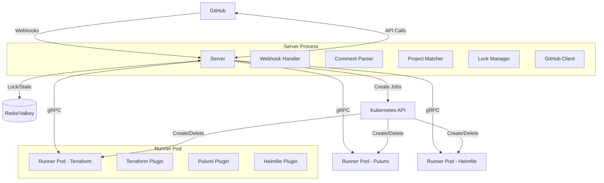

# Developing turnip

> **For developers**: people building turnip itself. Writing `turnip.yaml`
> or running a Server? See [the documentation entry page](../README.md).

Notes for contributors. Build, test and lint commands, and the
spec-driven workflow under `openspec/`, are in
[`CLAUDE.md`](../../CLAUDE.md).

## Architecture



- **Server** (`cmd/server`): a stateless HTTP/gRPC service. Receives GitHub
  webhooks, parses `turnip.yaml`, matches modified files against each
  project's `whenModified` globs, acquires a Redis lock before planning,
  creates a Kubernetes Job per triggered Operation, and posts a
  consolidated PR comment and check run once every Job reports back. All
  state lives in Redis, not in-process: any number of Server replicas can
  run behind one Service with no coordination between them (see
  [`docs/operating/deployment.md`](../operating/deployment.md)'s "Scaling
  up" section).
- **Runner** (`cmd/runner`): one ephemeral Kubernetes Job per Operation.
  Clones the repository at the PR's commit, runs the matched tool
  (Terraform/Pulumi/Helmfile) via a shared Plugin interface, and streams
  logs and a final result back to the Server over gRPC.

turnip's own manifests live under [`deploy/`](../../deploy/);
`deploy/overlays/kind/` is a complete, concrete worked example.

## Adding a tool

Everything turnip knows about a tool lives in that tool's Plugin, and the
Plugins turnip ships are listed in one place. Adding a tool is three steps,
all inside `internal/plugin`, and a documentation page; nothing else in
the code names a tool.
[`internal/plugin/helmfile.go`](../../internal/plugin/helmfile.go) is the
worked example.

### 1. Write the Plugin

Implement `plugin.Plugin` (`internal/plugin/plugin.go`):

| Method | Returns |
|---|---|
| `Name()` | the name repositories write in `uses:` and in trigger comments (`/<name> <operation>`) |
| `GetOperations()` | the tool's own operation names, not a shared vocabulary (helmfile: `diff`, `apply`, `sync`) |
| `GetPlanOperation()`, `GetApplyOperation()` | which of those plans and which applies |
| `ActsWithoutChanges()` | whether any operation besides the plan can change infrastructure when the plan found nothing (true for helmfile, because of `sync`) |
| `Provisioning()` | how the tool reaches a Runner Job; see step 2 |
| `Execute()` | runs one operation by shelling out to the tool's CLI |

`Execute` goes through the `commandRunner` seam in `command.go` rather
than calling `os/exec` directly, so the Plugin's tests can fake the
subprocess without a real binary or cluster (see `helmfile_test.go`).

The command's output is a `plugin.Record` (`record.go`): every line the
tool wrote, in the order it was read, each marked `Stdout` or `Stderr`,
between turnip's own annotation lines, which are marked `Turnip`. The
Runner follows the same Record while the command runs, for its own log
and for the lines it sends to the Server, so a Plugin does nothing for
either. Two things are the Plugin's to decide:

- **What the Operation's output is.** `Record.Text()` is the whole
  Record. `Record.Select(stream, note)` is one stream alone, with a line
  of the Plugin's wording saying how much was left out. Both keep
  turnip's annotation lines; return one of them as
  `ExecuteResult.Output`. Read change counts from the Record
  (`Record.StreamText(stream)`), never from the output you return.
- **How the tool's streams are captured.** `execCommand` gives each
  stream a pipe of its own, which is what lets a Plugin tell them apart.
  The order within a stream is exact; across the two it is the order
  written when the tool writes to one and then the other, and can be off
  by a little when it writes to both at the same moment. A tool that
  uses its streams conventionally, and whose Plugin needs neither `Select`
  nor a count read from one stream, is better served by one pipe for
  both, which is exact in every case. That capture does not exist yet:
  add it beside `execCommand` when a Plugin wants it.

### 2. Declare its provisioning

`Provisioning()` returns a `provisioning.Spec` (`internal/provisioning`):

- **`Image`**: the tool's image repository, **fully qualified** with its
  registry host (`ghcr.io/helmfile/helmfile`, not `helmfile/helmfile`),
  and with no tag. The tag is the version the repository writes in
  `uses:`, appended exactly as written, so `helmfile@v1.7.4` runs
  `ghcr.io/helmfile/helmfile:v1.7.4`. A Plugin never declares a default
  version.
- **`Strategy`**: one of two, both implemented once in `internal/jobs`:
  - **`CopyOut`**: an init container copies the tool's binary out of
    `Image` onto a shared volume, and turnip's own Runner image runs it.
    Right for a tool that is a single self-contained binary. Set
    **`BinaryPath`** to where that binary lives inside `Image`.
  - **`RunInImage`**: `Image` itself is the Job's main container, with
    turnip's runner binary copied in beside it, so the tool runs with its
    image's own `PATH`, environment and `HOME`. Right for a tool that
    needs helpers or plugins its image provides (helmfile needs `helm`,
    helm-diff and `sops`). Leave `BinaryPath` empty.

A new tool picks a strategy; it never builds Kubernetes objects itself.
If neither fits, the new strategy belongs in `internal/provisioning` and
`internal/jobs`, not in the Plugin.

### 3. Register it

Add the constructor to the list in
[`internal/plugin/registry.go`](../../internal/plugin/registry.go). That
one line is what makes the tool exist everywhere:

- `turnip.yaml` validation accepts it in `uses:` (and a tool with no
  Plugin is a validation error listing the registered ones);
- trigger comments accept `/<name> <operation>`;
- the Server and the Runner both find the Plugin through `Registry()`.

`registry_test.go`'s `TestRegistry_EveryPluginDeclaresItsProvisioning`
runs against every registered Plugin and fails unless its `Spec` is
complete: a known `Strategy`, a fully qualified `Image` with no tag, and
a `BinaryPath` exactly when the strategy is `CopyOut`. It exists so a
half-declared Plugin fails in `go test` rather than in a Runner Job, after
a Lock is held and a check is running.

### 4. Document it

A new plugin ships a `docs/plugins/<tool>.md` page, the one place for
everything specific to that tool; [`plugins/helmfile.md`](../plugins/helmfile.md)
is the model. The page opens with a two-line note saying which section is
for whom, and has two audience sections:

- **Using `<tool>`**, for people writing `turnip.yaml` and commenting on
  pull requests: its operations (which one is the plan, which are
  mutating, and whether any acts without changes), the `uses:` alias and
  the tags it allows, the `with:` keys, authentication from the
  repository's side, what its counts mean (including how its mutating
  commands report what they changed, and when they read `succeeded`),
  its gotchas, and the troubleshooting a pull request author meets.
- **Running `<tool>`**, for operators: the vendor image, how it is
  provisioned and what a custom image must provide, the identity and
  permissions the Runner needs and what that grant means, and the
  operator's gotchas.

The page describes behavior only. How the Plugin works inside (which
stream it parses, what output formats it recognizes, why it chose its
provisioning strategy) goes in a section of this file, as "The Helmfile
plugin" below does.

Then link the page from [`plugins/README.md`](../plugins/README.md)'s
tool table, and update that table's row.

## How a tool reaches the Runner

Two strategies, chosen per tool by turnip rather than configured (a
custom image always runs the second):

- **copy-out**: an initContainer copies the tool's binary out of the
  vendor's image onto a shared volume, and turnip's own image runs it.
  Correct for a tool that is a single self-contained binary.
- **run-in-image**: the vendor's image *is* the container that runs, with
  turnip's runner binary handed to it. The tool gets its own image's
  `PATH`, environment and `HOME`, so its helper binaries and plugins are
  simply present.

Each tool's page says which strategy it uses and why (Helmfile
[runs in its image](../plugins/helmfile.md#what-a-custom-helmfile-image-must-provide)).

The practical consequence: **for a run-in-image tool, its plugins and
helpers come from the image.** Needing one the vendor's image doesn't
bundle means building an image that has it and having the operator allow
it (see
[Running a custom image](../operating/runner-access.md#running-a-custom-image)), not
configuring turnip.

## Local development

`deploy/overlays/kind/` is a complete, runnable example for a local
[kind](https://kind.sigs.k8s.io/) cluster, useful for trying turnip out
or working on it, not for a real deployment (it pins a locally-built
`dev` image tag and a placeholder GitHub App ID). From a clone of this
repository:

```sh
kubectl create secret generic turnip-server-secrets \
  --from-literal=webhook-secret=<your-webhook-secret> \
  --from-file=private-key=<path-to-your-app-private-key.pem>

# A Redis/Valkey the overlay can reach as "redis:6379" (test/load/redis.yaml
# is a minimal example), or edit the overlay's TURNIP_REDIS_ADDR.

kubectl apply -k deploy/overlays/kind
```

### Checking the documentation

`make test` runs `make docs-check` first: [lychee](https://github.com/lycheeverse/lychee),
offline, confirms every relative link and `#anchor` in the tracked
Markdown resolves, the way GitHub renders them. The Makefile downloads
lychee at the version pinned in `build/tools/lychee/Dockerfile` (never
built; it exists so Dependabot opens a pull request for each new
release) into `bin/` on first use and checks it against the release's published checksum, so there is
nothing to install. Two Go tests keep the
References complete: a `turnip.yaml` field or a Server setting with no
row in [`turnip-yaml.md`](../using/turnip-yaml.md) or
[`server-settings.md`](../operating/server-settings.md) fails the build.

## The Helmfile plugin

How [`internal/plugin/helmfile.go`](../../internal/plugin/helmfile.go) and
`helmfile_parse.go` work inside. What this means for users and operators
is in [`plugins/helmfile.md`](../plugins/helmfile.md).

**Provisioning: run-in-image.** Helmfile is a runtime, not a binary: it
shells out to `helm`, `helmfile diff` needs the helm-diff plugin,
helm-secrets needs `sops`, and helm finds its plugins through an
environment its image sets. Copying one binary out produced exactly the
failure you'd expect: `exec: "helm": executable file not found in $PATH`.

**`ActsWithoutChanges` is true** because of `sync`, which runs
`helm upgrade --install` for every release regardless of the diff.
`apply` alone would answer false: it diffs first and syncs only the
releases that changed.

**The command line** is `helmfile --no-color [--environment <env>]
<operation> [arguments...]`. `--no-color` is a flag rather than
`NO_COLOR` in the environment so the command line turnip annotates shows
why the output has no color.

**The output** is `Record.Text()` when Helmfile exits 0 and
`Record.Select(Stderr, ...)` otherwise. Helmfile's logger writes to
standard error: its progress, its release tables, its errors, and what
`helm upgrade` prints. Standard output carries only the diffs, which
`helmfile diff` holds in memory per release and prints in one burst once
the last release is done. A failed operation's errors are therefore all
on standard error, and its diffs are megabytes nobody can apply. That
burst is also why the capture reads both pipes from one loop (see
`readStreams`): a reader per pipe recorded the errors that follow the
burst in the middle of it.

**Counting a `diff`** reads changes from standard output. Each
`Comparing release=<name>, chart=<chart>` header followed by at least one
non-blank line before the next header (or the end) is one changed
release, reported as `Change`. A release Helmfile will remove has no diff;
it is read from the `Affected releases are:` summary on standard error
instead, each `  <name> (<chart>) DELETED` line counting one `Destroy`
(`parseAffectedReleases`). The summary ends at the first line that is
neither blank nor a release line, summaries are summed (one per
sub-helmfile), and `UPDATED` lines, printed only with
`--detailed-exitcode`, count nothing. Apart from that summary, standard
error carries everything
Helmfile says itself ("Building dependency", "Adding repo", a failed
helm diff), which would otherwise read as the body of whichever release
it landed after. turnip's own annotation lines are a stream of their
own in the Record, so they are not in what is counted.

**Counting an `apply` or `sync`** reads standard error only, where
Helmfile prints its Release_Tables when it finishes; standard output
carries diff bodies and manifest content that must not be read as one.
A table is a `=`-framed banner (`=== Updated Releases ===`, as Helmfile
prints from v1.6.0 on), a header row that is skipped, then one row per
release until a blank line or the next banner. `Updated Releases` and
`Reinstalled Releases` rows count as `Change`, `Deleted Releases` rows as
`Destroy`; any other title (the failed tables) is skipped. Tables are
summed, since Helmfile prints one set per sub-helmfile. ANSI color codes
are stripped first.

**When counts are not reported** (`ChangesReported(operation, output)`
returns false, and the run renders `succeeded`), judged from the whole
transcript. The Server asks it for every successful operation, the plan
included; for Helmfile:

- for an `apply` or `sync`, one of the older upper-case banners
  (`UPDATED RELEASES:`, `REINSTALLED RELEASES:`, `DELETED RELEASES:`,
  `FAILED RELEASES:`, `FAILED TO DELETE RELEASES:`) appears, meaning a
  Helmfile before v1.6.0 whose tables are not parsed;
- for any of `diff`, `apply` or `sync`, the command annotation's argv
  sets the log level above info, which silences both the Release_Tables
  and the `diff`'s `Affected releases are:` summary: `-q`, `--quiet`, or
  `--log-level` `warn`, `error`, `dpanic`, `panic` or `fatal`, following
  Helmfile's precedence (`--debug` wins over `--quiet`, which wins over
  `--log-level`; parsing stops at `--`).

`HELMFILE_QUIET` and `HELMFILE_LOG_LEVEL` in the environment are not
visible to this check, which is why the user docs say not to set them.
