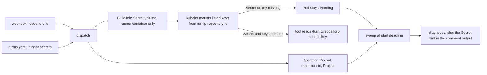

# Design

## Context

See `proposal.md` for why, and the four spec deltas for the behavior.
The pieces this change touches, as they are today:

- **`internal/config`** keeps the `runner:` fields in `RunnerSpec`
  (`ServiceAccount`, `Env`). The merge of the two levels is driven by a
  table, `runnerMergeRules`, keyed by field name; a test fails for a
  field without a rule. Its only replace rule assigns the value as it
  is, which its own comment says is safe for scalars only. The package
  is a leaf with no Kubernetes dependency, and its YAML round trip is
  covered by a property test.
- **`internal/github`** maps a webhook's repository to `Repository`
  (owner, name, URL). The numeric id is in the payload but not kept.
- **`internal/jobs`** builds the Runner Pod from the Project and
  `OperationParams`. The `runner` container is the tool's container
  under both provisioning strategies.
- **`internal/orchestrator`** stores an Operation Record per dispatch
  (holding the whole `config.Project`, so the listed keys are already
  in it) and, in the sweep, turns a `JobStatus` (Pod phase, waiting
  reason) into the start-timeout diagnostic.

## Goals / Non-Goals

**Goals**
- The keys a Project lists reach its tool's container as files, and
  nothing else of the Secret does
- The Secret's name is computed in one place, from a value the pull
  request cannot influence
- The Server's Kubernetes permissions do not change

**Non-Goals**
- Checking that the Secret or a key exists before dispatch
- A mount path per key, or a path the repository chooses
- Any change to `deploy/` or the Server's RBAC

## Flow



The Server never reads the Secret: it only names it in the Pod spec,
and the kubelet resolves it.

## Decisions

### 1. The name is derived by one exported function in `internal/jobs`

```go
// RepositorySecretName is the name of the Secret a repository's Runner
// Pods mount keys from: "turnip-repository-<id>".
func RepositorySecretName(repositoryID int64) string
```

`BuildJob` calls it from a new `OperationParams.RepositoryID`, and the
sweep calls it for the hint, so the two can never name different
Secrets.

- **Alternative considered:** store the Secret's name in the Operation
  Record at dispatch.
- **Rejected because:** it is a second copy of a value derivable from
  the id; one function keeps the Pod and the hint naming the same
  Secret by construction.

### 2. Absent and empty lists stay different everywhere

`secrets` absent means "inherit"; `secrets: []` means "mount nothing".
That difference has to survive parsing, the merge, the Operation
Record's JSON, and YAML re-marshaling. The trap is YAML's `omitempty`,
which drops an empty list exactly as it drops an absent one, so a
re-marshaled opt-out would come back as an inherit. The field's type
therefore treats only the absent value as zero, and the configuration
round-trip property generates absent, empty and non-empty lists.

The merge table gains a rule for replaced lists that copies the
winning list, so Projects inheriting the top-level list never share
its backing array (the hazard the existing replace rule's comment
warns about).

- **Alternative considered:** treat `[]` as absent, with no opt-out.
- **Rejected because:** the proposal decided a Project's list
  replaces the top-level one precisely so a Project can opt out.

### 3. Key names are validated in `internal/config` without Kubernetes

The rule (1 to 253 of `[-._a-zA-Z0-9]`, not `.`, not starting with
`..`) is implemented in `internal/config` itself. A test checks it
against Kubernetes' own `IsConfigMapKey` over a corpus and a rapid
property, so the two cannot drift.

- **Alternative considered:** call `k8s.io/apimachinery`'s validation
  from `internal/config`.
- **Rejected because:** the package is a leaf with no Kubernetes
  dependency, and a test-only import keeps it that way while still
  catching drift.

### 4. One Secret volume with listed items, mounted at a directory

| Field | Value | Why |
|---|---|---|
| volume | `repository-secrets`, source Secret `RepositorySecretName(id)` | |
| `items` | one per listed key, `path` equal to the key | only listed keys appear |
| `defaultMode` | `0444` | a non-root tool user can read it |
| `optional` | false | a missing Secret or key fails visibly, at the start timeout |
| mount | `/turnip/repository-secrets`, `readOnly`, `runner` container only | |

No volume is added when the effective list is empty.

- **Alternative considered:** a `subPath` mount per key, which would let
  each key land anywhere.
- **Rejected because:** a `subPath` mount never receives an updated
  Secret, and the spec fixes one directory.

### 5. The repository id travels with the Operation; zero refuses

The id is read from the webhook into `Repository`, which already
travels with every Target to dispatch on both trigger paths (on the
comment path it is the webhook's own repository, never the pull request
fetched separately), written to the Operation Record (for the sweep)
and passed to `BuildJob`. When a Project lists keys and the id is
zero, `BuildJob` returns an error, so the Operation is refused through
the existing `Runner Job could not be built` path.

- **Alternative considered:** mount `turnip-repository-0`, or skip the
  volume.
- **Rejected because:** the first names a Secret that cannot be the
  repository's, and the second turns a turnip bug into a tool failing
  with a missing file, or a Pod that never starts.

### 6. The hint is added in the sweep, from the record

The sweep already reads `JobStatus`. When the record's Project lists
keys and the Pod's phase is `Pending`, the output given to the results
comment becomes the diagnostic, then a newline, then the hint line from
the `operation-lifecycle` spec, built from the record's repository id,
the listed keys and the Server's Runner namespace. The check's title is
built from the diagnostic before the hint is added. Pod events are not
read (see the proposal's Decisions).

## Risks / Trade-offs

- [Any collaborator's pull request can read and print every listed key
  at plan time] → documented in `docs/plugins/helmfile.md`,
  `docs/operating/runner-access.md` and `SECURITY.md`. A Secret mounted
  only for mutating Operations is left for a later change.
- [A Runner ServiceAccount allowed to read or create Secrets in the
  Runner namespace can read, or plant, another repository's Secret] →
  documented; `split-server-runner-namespaces` keeps turnip's own
  Secret out of that namespace.
- [The files are read-only, so a tool that writes to its `KUBECONFIG`
  fails (`kubectl config use-context`, `aws eks update-kubeconfig`)] →
  the Helmfile guide selects the context with `kubeContext`, which only
  passes `--kube-context`, and says not to write to a mounted file.
- [The hint shows for any Pod still `Pending`, including one that is
  unschedulable for other reasons] → it is worded as a condition, so it
  is never false.
- [A Secret updated while an Operation runs reaches its files a little
  later, so a plan and its apply may see different contents] →
  accepted: the Secret is the operator's, and the apply already runs
  in a Pod of its own.

## Migration Plan

None: the field is new, and a repository without a Secret behaves as
today. No RBAC or manifest changes. To use it, the operator creates the
Secret in the Runner namespace, for example:

```sh
id=$(gh api repos/OWNER/REPO --jq .id)
kubectl -n <runner-namespace> create secret generic "turnip-repository-$id" \
  --from-file=poc-kubeconfig=./kubeconfig
```

## Open Questions

- Which waiting reason a Pod reports while its Secret volume cannot be
  mounted (`PodInitializing` or `ContainerCreating`). The hint keys on
  the phase, so the answer changes only the diagnostic's own text; a
  kind cluster run during implementation settles it for the docs.
  - **Answer:** `PodInitializing`, observed by
    `TestKind_RepositorySecretMount` (`make test-kind`, kind node
    v1.37.0) with a key the Secret lacks. Every Runner Pod has a `clone`
    init container, and the kubelet reports both it and `runner` as
    waiting with reason `PodInitializing` and an empty message, phase
    `Pending`, for the whole 60 seconds; no container starts, not even
    the init container that does not mount the volume, because the
    kubelet mounts all of a Pod's volumes before starting any of them.
    So the start timeout's diagnostic is
    `Job <name>: container stuck (PodInitializing)`, and the hint
    follows it. The cause is only in the Pod's events:
    `FailedMount` with `MountVolume.SetUp failed for volume
    "repository-secrets" : references non-existent secret key: <key>`.
