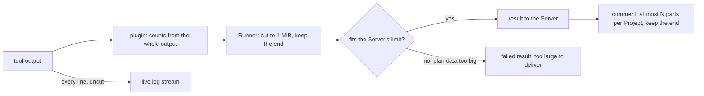

# Design

## Context

See `proposal.md` for why, and the four deltas for the behavior. As the
code stands:

- **The Server's gRPC limit is implicit.** `rpc.NewServer` passes no
  message-size option, so gRPC's default 4 MiB receive limit applies,
  and nothing on the Runner knows that number.
- **The Runner builds its result** in `runner.execute` from the plugin's
  `ExecuteResult` (`Output: clean(result.Output)`), then logs it whole
  with `%+v` before reporting it. The reporter retries every failure the
  same way, a size rejection included.
- **The comment splits a Project's output by bytes** in
  `github.splitDetailSection` into as many parts as it needs, each under
  `maxCommentLength` (65,536) with its scaffolding, and already has a
  marker for cut output, `…(earlier output omitted)`.

## Goals / Non-Goals

**Goals**
- A result always fits what the Server accepts, by construction
- The comment's length is bounded per Project, by the operator
- The Runner's log keeps the tool's output once

**Non-Goals**
- Any change to the live log stream: every line still goes to the
  Server uncut (Slice 26 needs the whole log)
- Storing the full output (Slice 26, then long-term storage)
- Sending a result in several messages

## Flow



## Decisions

### 1. One limit, named once, checked before sending

A constant in `internal/rpc`, the largest result message, set to 4 MiB,
is passed to the Server as `grpc.MaxRecvMsgSize` and read by the
Runner. The Runner checks the size of the result message it is about to
send against it; one that does not fit is never sent, and the failed
"too large to deliver" result goes instead. The Runner also treats a
`ResourceExhausted` answer to a result as final, in case the Server it
reached was configured differently.

- **Alternative considered:** rely on the error alone: send, and stop
  retrying when the Server answers `ResourceExhausted`.
- **Rejected because:** it spends a round trip on a send that cannot
  succeed, and the Runner would be guessing what that code means. With
  the limit named once, the two sides cannot disagree. The spec's "a
  result the Server refuses for its size is not retried" holds either
  way.

### 2. The Runner cuts after the plugin, before the message

`runner.execute` cuts `ExecuteResult.Output` after `Execute` returns,
so the plugin has already read its counts from the whole output, and
after workspace paths are stripped, so the 1 MiB is what the Server
receives. The leading run of `@@ turnip: … @@` lines and the closing
one are kept; the tool lines are removed from the start until the rest
fits, and the omission line goes after the leading run. A single tool
line longer than the whole budget keeps its own end, cut inside the
line. `PlanData` is never touched.

- **Alternative considered:** cut in the shared capture
  (`internal/plugin`), as the output is recorded.
- **Rejected because:** the plugin must see the whole output to count,
  and the composed output is the plugin's (`fix-output-order`), so the
  cut belongs after it, at the one place that sends.

### 3. The result log line summarizes

The `%+v` dump becomes the spec's `key=value` line, built from the
`OperationResult` and the sizes before and after the cut. The result's
error message, which the dump used to carry (why a tool could not start,
say), gets a line of its own, `runner: operation error: <message>`,
logged just before the summary when there is one.

### 4. The comment caps parts per Project in the splitter

`splitDetailSection` gets the cap. When a Project's output would need
more parts than the cap, it cuts the start of the output after the
leading `@@ turnip:` lines, counting the lines it removes, so the rest
fits the cap's parts, and puts `…(<K> earlier lines omitted)` after
those lines. The leading lines include the Runner's own omission line,
so both notes reach the reader. The annotation format is turnip's own
transcript, not a plugin's, so the Server reading it is not plugin
plumbing.

The cap reaches the comment through the one exported entry point:

```go
func BuildConsolidatedComment(results []ProjectResult, maxPartsPerProject int, notices ...string) []string
```

- **Alternative considered:** a package-level setting in
  `internal/github`.
- **Rejected because:** the value is the Server's configuration, and a
  parameter keeps the comment a pure function of its inputs, as its
  tests already assume.

### 5. The setting is read with the others

`orchestrator.ConfigFromEnv` reads `TURNIP_MAX_COMMENTS_PER_PROJECT`
beside `TURNIP_MINIMIZE_OUTDATED_PLAN_COMMENTS`, defaults it to 5, and
refuses a value that is not a positive integer, naming the setting and
the value. The settings Reference test then requires its row in
`docs/operating/server-settings.md`.

## Risks / Trade-offs

- [The cut removes the start, where an early error may be] → the end
  holds a plan's summary and a failure's last error; the whole output is
  in the Runner's log for operators, and in the live view once Slice 26
  exists.
- [Two omission notes in one section] → each says what it counted (the
  Runner's before sending, the comment's after); the troubleshooting
  page explains both.
- [A tool's plan data alone exceeds what fits] → its Operation fails
  with "too large to deliver", rather than hanging; no plugin today
  sends plan data that large.
- [This change and `redis-tls-auth` both rewrite the Settings index] →
  this delta is written on `redis-tls-auth`'s version, so
  `redis-tls-auth` is archived first.

## Migration Plan

None. The setting is optional and defaults to 5. The explicit gRPC
limit is the value gRPC already used.
