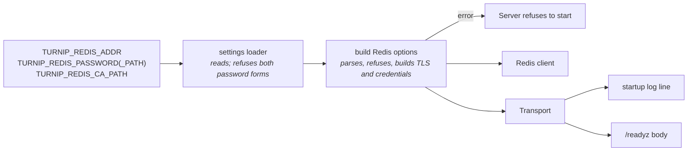

# Design

## Context

See proposal.md for why. The Server builds its one Redis client in
`cmd/server` from `TURNIP_REDIS_ADDR` alone. go-redis is at v9.22.0,
whose `ParseURL` already understands `redis://` and `rediss://`, a
username and password, a database number, about twenty tuning query
parameters, `skip_verify`, and a `unix://` scheme; it refuses query
parameters it does not recognize. Every Redis operation turnip performs
touches a single key (its Lua scripts and its one transaction alike).

## Goals / Non-Goals

**Goals:**
- Connect to a Redis that requires TLS, AUTH or both, with certificate
  verification always on
- Make the transport actually in use visible, so a one-letter typo in the
  scheme cannot silently mean plaintext
- Let an ElastiCache AUTH token rotate without restarting the Server

**Non-Goals:**
- Clustered Redis (ElastiCache cluster mode enabled): documented as
  unsupported, not detected or supported
- IAM authentication, mutual TLS

## Flow



One function, beside the settings loader (which already depends on
go-redis), turns the settings into go-redis options plus a Transport
record, or a startup error naming the fix. Its contract:

```go
func redisOptions(cfg Config) (*redis.Options, Transport, error)
```

## Decisions

### Decision 1: TLS is inferred from the scheme

`rediss://` means TLS, `redis://` means none, a bare `host:port` keeps
today's behavior (go-redis's `ParseURL` refuses a schemeless value, so
the bare form is kept by not parsing it as a URL).

*Alternative considered*: a `TURNIP_REDIS_TLS` switch.
*Rejected because*: a second source of truth for a fact the address
already states; the two could disagree. The cost, a typo silently
meaning plaintext, is paid for by Decision 6.

### Decision 2: A username in the URL, a password never

A password in the URL is a startup error naming the password settings.

*Alternative considered*: accept it, as go-redis would.
*Rejected because*: turnip's own manifests deliver `TURNIP_REDIS_ADDR`
through the Server's ConfigMap, so a password there lands in a
ConfigMap, not a Secret, and would be echoed by the startup log line.

### Decision 3: The password from a file or a value, the file re-read per connection

`TURNIP_REDIS_PASSWORD_PATH` (recommended, a mounted Secret) or
`TURNIP_REDIS_PASSWORD`; both set is a startup error. The file is read
through go-redis's per-connection credentials provider, and once at
startup so a missing file fails immediately.

*Alternative considered*: read the file once at startup.
*Rejected because*: ElastiCache rotates an AUTH token by accepting the
old and new together for a while, and Kubernetes updates a mounted
Secret's file in place; reading per connection lets a rotation finish
with no restart. Connections are pooled, so reads are rare.

### Decision 4: Everything go-redis reads, except two keys and one scheme

The URL may carry a database number and every tuning parameter
`ParseURL` understands. Refused: a password (Decision 2), `skip_verify`
by its presence whatever its value, checked on the raw query before
`ParseURL` acts on it, and any scheme other than `redis`/`rediss`
(`unix://` included: a Server Pod has no Redis socket to reach).

*Alternative considered*: an allowlist of parameters, or none.
*Rejected because* (decided 2026-09-30): the rule is that the address
may say anything except a secret or a switch that disables verification;
an allowlist would have to track go-redis's own list.

*Alternative considered for `skip_verify`*: refuse only `true`.
*Rejected because*: `skip_verify=false` changes nothing and invites
flipping one word later; the parameter has no supported use.

### Decision 5: A private CA by path, only with TLS

`TURNIP_REDIS_CA_PATH` replaces the trusted roots for a `rediss`
address; it must hold at least one certificate. Set without `rediss`, it
is a startup error, since it would otherwise do nothing, silently.

### Decision 6: The transport is reported, never inferred twice

| Field | Value |
|---|---|
| `addr` | `host:port`, rebuilt from the parsed host and port, never the setting's text |
| `tls` | true for `rediss` |
| `auth` | `none`, `username`, `password`, or `username+password` |
| `custom_ca` | whether `TURNIP_REDIS_CA_PATH` was used |

Logged at INFO after the first successful ping
(`redis connected addr=cache.example.com:6379 tls=true auth=password custom_ca=false`),
and returned under `redis` in a JSON body on `/readyz`, which keeps its
200/503 contract.

### Decision 7: A single, non-clustered endpoint

turnip keeps go-redis's single-node client. ElastiCache cluster mode
disabled (a primary, optionally replicas) works; cluster mode enabled
does not, and the documentation says so, naming the symptom (`MOVED`
errors).

*Alternative considered*: go-redis's universal or cluster client.
*Rejected because* (decided 2026-09-30): one primary is ample for
turnip's load, a replica covers failover, and because every operation
touches one key, supporting a cluster later is a change of client, not
of data layout.

## Risks / Trade-offs

- [A `redis://` typo yields plaintext] → the transport is logged and on
  `/readyz` (Decision 6), and the docs tell operators to check it
- [A password file that disappears after startup] → that connection
  fails with the read error logged, as a refused password would
- [ElastiCache Serverless compatibility is unverified] → see Open
  Questions; documented either way, never assumed

## Migration Plan

For the repository owner (no code migration; pre-1.0):
1. Create the ElastiCache instance: cluster mode disabled, in-transit
   encryption, an AUTH token, persistence as the deployment docs require
2. Store the token in a Secret mounted at the path set in
   `TURNIP_REDIS_PASSWORD_PATH`; set `TURNIP_REDIS_ADDR=rediss://…`
3. Deploy, and confirm `tls=true auth=password` in the startup line or
   `/readyz`
4. Every pull request plans again: the new instance starts empty

## Open Questions

- Whether ElastiCache Serverless works with a single-node client: to be
  checked against AWS's documentation during implementation and stated
  in the docs either way. It changes no requirement: the requirement is
  a single endpoint.
