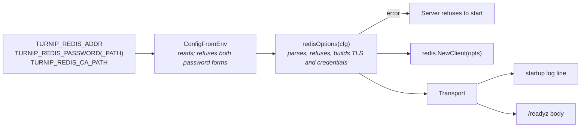

# Design: Authenticated and Encrypted Redis (Slice 27)

## Overview

One function turns the Server's Redis settings into go-redis's
`*redis.Options`, refusing what the requirements refuse, and reports the
Transport it chose. `cmd/server` builds the client from it, logs the
Transport, and hands it to the readiness endpoint. Nothing outside the
Server changes; the Runner never sees Redis.



## Reading the settings

Three new settings, all read in `ConfigFromEnv` (Requirement 7), each
gaining its row in `docs/operating/server-settings.md`:

| Setting | Meaning | Required |
|---|---|---|
| `TURNIP_REDIS_PASSWORD_PATH` | a file holding the AUTH password, typically a mounted Secret | no |
| `TURNIP_REDIS_PASSWORD` | the AUTH password itself | no |
| `TURNIP_REDIS_CA_PATH` | a PEM bundle of CA certificates to verify the server against | no |

Both password forms set is a `ConfigFromEnv` error (Requirement 4.2).
Everything that needs the address parsed is checked in the next step,
which `cmd/server` calls right after `ConfigFromEnv`.

## From settings to options

`redisOptions(cfg Config) (*redis.Options, Transport, error)` lives in
`internal/orchestrator` beside `ConfigFromEnv`, which already depends on
go-redis. Its checks, in order, each a startup error naming the fix:

| Address | Result |
|---|---|
| no `://` | `Options{Addr: value}`, exactly as today (Requirement 1.3) |
| scheme other than `redis` or `rediss` | refused; `unix://` included, since a Server Pod has no Redis socket to reach |
| `skip_verify` among the query keys | refused, whatever its value (Requirement 5.1); checked on the raw query before `ParseURL`, which would otherwise act on it |
| a password in the userinfo | refused, naming `TURNIP_REDIS_PASSWORD_PATH` (Requirement 3.2) |
| anything else | `ParseURL`, which reads the username, database number and tuning parameters, and itself refuses unknown ones (Requirement 6) |

Then, on the parsed options:

| Setting | Effect |
|---|---|
| `TURNIP_REDIS_CA_PATH` with a `rediss` address | its certificates become `TLSConfig.RootCAs`; an unreadable file or one with no certificate is a startup error |
| `TURNIP_REDIS_CA_PATH` without one | refused (Requirement 5.3) |
| a password setting | credentials as described below |

`ParseURL` already sets TLS 1.2 as the minimum and the server name from
the host; nothing else in `TLSConfig` changes.

### Decision 1: Refuse `skip_verify` by its presence, not its value

*Alternative considered*: refuse only `skip_verify=true`.

*Rejected because*: `skip_verify=false` changes nothing today, and
accepting it invites flipping one word later. The parameter has no use
turnip supports, so its presence is the error.

## Credentials

A username comes from the URL. A password comes from one of the two
settings, through go-redis's `CredentialsProviderContext`, which runs
on every new connection:

| Source | Read |
|---|---|
| `TURNIP_REDIS_PASSWORD_PATH` | the file, on every new connection, trailing newline trimmed; read once at startup too, so a missing or unreadable file fails startup rather than the first connection |
| `TURNIP_REDIS_PASSWORD` | the value |

### Decision 2: Re-read the password file per connection

*Alternative considered*: read it once at startup.

*Rejected because*: ElastiCache rotates an AUTH token by accepting the
old and new together for a while, and Kubernetes updates a mounted
Secret's file in place. Reading per connection lets a rotation complete
with no Server restart. Connections are pooled and long-lived, so the
read is rare, and a failing read fails that connection with the error
logged, the same as a refused password would.

## The Transport, visible

`Transport` is the plain record of what was configured:

| Field | Value |
|---|---|
| `Addr` | `host:port`, with no userinfo |
| `TLS` | true for `rediss` |
| `Auth` | `none`, `password`, or `username+password` (a username with no password is `username`) |
| `CustomCA` | whether `TURNIP_REDIS_CA_PATH` was used |

At startup, after the first successful ping, the Server logs it at INFO:

```text
INFO redis connected addr=cache.example.com:6379 tls=true auth=password custom_ca=false
```

`/readyz` answers as today (200 or 503) and adds a JSON body with the
same fields under `redis`, so a probe or a person can confirm TLS
without reading logs (Requirement 2.2). No field ever holds a
credential, and the address is rendered from host and port, never from
the setting's text (Requirement 3.3).

## Documentation

| Where | What |
|---|---|
| `docs/operating/deployment.md`, Redis prerequisite | rewritten: Redis with persistence, reached as a single endpoint (not clustered; ElastiCache cluster mode disabled, a primary and optionally replicas; Serverless checked against AWS's documentation and stated either way), with TLS and AUTH supported; `MOVED` errors as the symptom of a clustered endpoint; the version floor (5.0, 6.0 for a username) |
| `docs/operating/deployment.md`, new section | connecting to ElastiCache: in-transit encryption and an AUTH token; the `rediss://` address; the token in a Secret mounted at `TURNIP_REDIS_PASSWORD_PATH`; how to confirm TLS from the log line or `/readyz` |
| `docs/operating/server-settings.md` | the three new rows; `TURNIP_REDIS_ADDR`'s row describes the three forms, links go-redis's parameter list, and names the two refusals |
| `docs/operating/troubleshooting.md` | each startup refusal, and `MOVED` |

## Testing

- **`redisOptions`**, table-driven: the bare form unchanged; `redis` and
  `rediss`; a username; a database number and a tuning parameter
  reaching the options; an unknown parameter refused (by `ParseURL`);
  `unix://`, `skip_verify=true`, `skip_verify=false` and a password in
  the URL each refused with its message; a CA bundle loaded, an empty or
  unreadable one refused, and one without `rediss` refused.
- **Credentials**: the provider re-reads the file, so a rewritten file
  is the next connection's password; a trailing newline is trimmed; a
  missing file fails at startup.
- **A real TLS connection**: miniredis (already a test dependency)
  serving TLS (`RunTLS`) with a certificate from a CA generated in the
  test, and requiring AUTH (`RequireAuth`, `RequireUserAuth`). The
  client built from `redisOptions` connects with `TURNIP_REDIS_CA_PATH`
  and the password; it is refused without the CA, with a wrong password,
  and over `redis://` to the TLS port. This is the test that shows TLS
  and AUTH are real rather than configured, and it runs everywhere, with
  no external Redis.
- **No credential leaks**: the log line and `/readyz` body checked for
  the password and the URL's userinfo.
- **The settings Reference test** passes with the three new rows.
