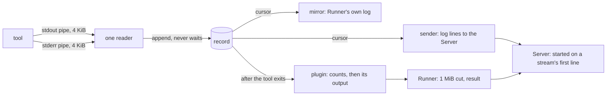
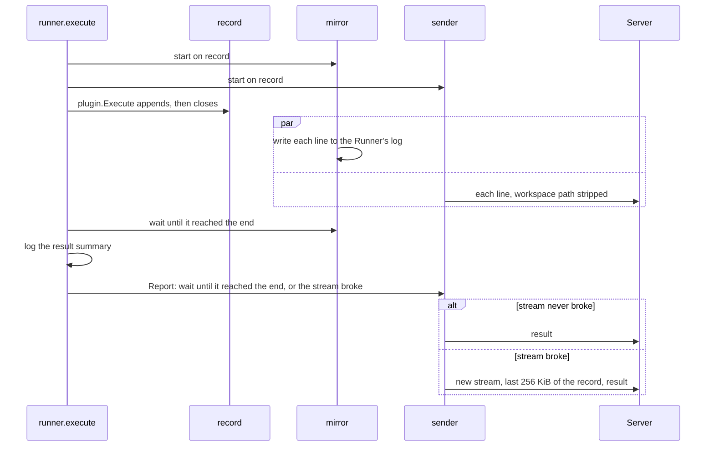

# Design

## Context

See `proposal.md` for why, and the three deltas for the behavior. As the
code stands:

- **The capture merges through a channel.** `plugin.execCommand` scans
  each pipe with a 64 KiB `bufio.Scanner` in its own goroutine; both
  send to one unbuffered channel, and a single consumer appends each
  line to the record and then calls `OnOutput`. That call writes the
  line to the Runner's own log and sends it to the Server, so a slow
  Server holds the consumer, the consumer holds both scanners, and
  whatever the pipes buffer meanwhile is merged out of order.
- **Turnip's annotation lines are recorded as standard output.** A
  selection by stream would lose them, and Helmfile's count of changed
  releases has to skip them by their text.
- **The plugin returns text.** `HelmfilePlugin.Execute` joins every line
  of the record into `ExecuteResult.Output`; nothing lets a plugin
  choose.
- **The Runner holds each line twice.** The record keeps every line, and
  `reporter` keeps the last 256 KiB again in a ring buffer, which it
  replays before every result, on a stream that never broke too.
- **The Server calls Redis for every line.** `rpc.Server` hands each log
  line to `Orchestrator.HandleLog`, which runs the mark-started script
  each time and reads nothing else from the line.

## Goals / Non-Goals

**Goals**
- The record is in write order when the tool writes to one stream and
  then to the other, a burst of any size included
- Nothing downstream of the record (the Runner's log, the Server) can
  slow the recording or the tool
- A plugin chooses its output by stream without being able to drop
  turnip's lines
- One copy of the output in the Runner's memory

**Non-Goals**
- Exact order for writes to both streams at the same moment or within
  microseconds (only one shared pipe gives that; see the proposal's
  Decisions)
- The combined capture, one pipe for both streams, for a plugin that
  wants it: added with the first one that does (Decision 8)
- Resuming a broken stream from the last line the Server stored (Slice
  26); the replay stays the last 256 KiB
- Any change to the wire format, or to what the Server does with a log
  line's content
- The order of `kubectl logs`: the Runner still writes to its own
  standard output and standard error, which the container runtime merges
  itself
- The 1 MiB limit on a single line, which stays as it is

## Flow



The record is the only thing the reader touches. The mirror and the
sender each follow it at their own pace; the plugin reads it whole once
the tool has exited.

## Decisions

### 1. The record is a type of its own, with cursors

The slice of lines the capture returns today becomes a `Record` in
`internal/plugin`: append-only while the tool runs, closed after the
closing annotation line, safe to read while it grows. A reader of it
asks for the lines after a position and waits when there are none yet.

```go
type Stream int // Stdout, Stderr, Turnip

type Line struct {
	Stream Stream
	Text   string
	At     time.Time // when it was recorded
}

// Next returns the lines after position from, waiting until there is at
// least one, the record is closed (done), or ctx ends.
func (r *Record) Next(ctx context.Context, from int) (lines []Line, done bool)
```

Appending takes the record's lock for the append alone and wakes
waiting readers; it never calls out. `At` is what a log line's
timestamp becomes, so a line sent late still says when the tool wrote
it.

- **Alternative considered:** keep `OnOutput`, called by the reader,
  and have the Runner's callback put lines on an unbounded queue.
- **Rejected because:** the queue is a second copy of the record, and a
  callback under the record's lock is one careless change away from
  blocking it again. A cursor cannot block the writer by construction.

### 2. One reader over both pipes, on small pipes

The capture creates the tool's two pipes itself, shrinks each to one
page (4 KiB) where the system allows it (Linux), and reads both from one
loop:

- it waits until either pipe has data
- it takes what a pipe holds now in one read, splits it into lines and
  appends every complete line to the record
- when both pipes have data, it takes first the stream it took last
  round: that is the one it is behind on, so what that pipe still holds
  was written before the other stream's line

A line is recorded when its newline is read; an unterminated last line
is recorded when the pipe closes. The reader calls nothing but the
record's append.

The reader is waiting on the pipes before the tool starts, and holds
what it reads until the opening annotation lines are in the record.
Started after the tool, it found the tool's first lines on both pipes at
once under load, with nothing to order them by (found at
implementation; see `tasks.md`).

The small pipe is what bounds the error: the tool can never be more than
4 KiB ahead of the reader on a stream, so a line that does land out of
place lands within about that much output of where it was written.
Without it, a line written between two bursts was still up to 6,826
lines out.

Measured 2026-10-12, sixty runs each, with a writer that numbers its
lines (see the proposal for the Helmfile pattern):

| What the tool writes | Two readers | Two readers, 4 KiB pipes | One reader, 4 KiB pipes |
|---|---|---|---|
| 20,000 lines one at a time, then 5 errors | in order | in order | in order |
| one 20,000-line write, then 5 errors | 60 runs wrong, up to 9,379 lines out | 7 wrong, up to 709 | in order |
| error, burst, error, burst, error | 60 wrong, up to 9,352 | 44 wrong, up to 860 | in order |
| a switch of stream every line, no pause | every run wrong | every run wrong | every run wrong |
| a switch every line, 1 ms apart | in order | in order | in order |
| 50 MB captured | 266 ms | 275 ms | 297 ms |

- **Alternative considered:** two readers, one per pipe, each appending
  as it reads (this design's first version, built and measured).
- **Rejected because:** the reader of the quiet stream records its line
  while the reader of the busy one still has a pipe's worth to work
  through, so whatever follows a burst lands inside it. That is
  Helmfile's shape exactly: its errors follow one burst holding every
  release's diff.
- **Alternative considered:** the same reader with a rule that prefers
  the newly active stream unless the reader is behind.
- **Rejected because:** measured, it changed nothing that matters.
- **Alternative considered:** one pipe shared by both streams.
- **Rejected because:** see Decision 8.

The reader uses `poll` and raw reads through `golang.org/x/sys/unix`,
which becomes a direct dependency. Shrinking a pipe is Linux's
`F_SETPIPE_SZ`; on another Unix the pipes keep their size and the bound
is the pipe's own.

### 3. Turnip's lines are a stream of their own

Annotation lines are recorded as `Turnip`, neither `Stdout` nor
`Stderr`. Selecting by stream then needs no parsing to keep them,
Helmfile's count of changed releases reads `Stdout` without having to
skip them, and the number of omitted lines is the number of `Stdout`
lines, exactly. The mirror writes them to the Runner's standard output
and the sender gives them level `info`, as today.

- **Alternative considered:** keep recording them as standard output and
  recognize them by the `@@ turnip: ` prefix.
- **Rejected because:** a tool can print a line of that shape, and every
  consumer would have to repeat the test.

### 4. The record composes the output, the plugin chooses

`ExecuteResult.Output` stays text, so nothing after the plugin changes:
the 1 MiB cut, the result, the Server. The plugin gets that text from
the record, which offers two compositions and no way to enumerate lines
into a third without writing one on purpose:

```go
// Text is the whole record.
func (r *Record) Text() string

// Select is the leading Turnip lines, then note(omitted) as an
// annotation line when it returns text, then the lines of keep in
// order, then the closing Turnip line. omitted is the number of lines
// left out.
func (r *Record) Select(keep Stream, note func(omitted int) string) string
```

Both keep turnip's lines, which is how "no tool can leave them out"
holds. Where the note goes is fixed here (right after the leading
annotation lines, where the 1 MiB cut and the comment's cap both keep
it); what it says is the plugin's.

- **Alternative considered:** the plugin returns a selection (a stream
  and a note) and the Runner composes the text.
- **Rejected because:** it moves a per-tool choice into
  `ExecuteResult`, and a later plugin that needs something else (two
  streams in a different order, say) would need the shared type changed
  rather than a method added.

### 5. The Runner owns the record's consumers

`ExecuteOptions.OnOutput` is replaced by `ExecuteOptions.Record`. The
Runner creates the record, starts the mirror and the sender on it, and
passes it to `Execute`; the capture appends to it and closes it. A
caller that passes none (the plugin's own tests) gets one the capture
makes.



- The mirror is waited for before the result summary is logged, so the
  summary still follows the output in `kubectl logs`.
- The sender stops at the first failed send, as `LogLine` does today,
  and does not reconnect while the tool runs. `Report` then opens the
  new stream and replays from the record: the lines whose sizes
  (timestamp, level, message) sum to at most 256 KiB, counted back from
  the end, preceded by `<N> lines dropped` when the record has more.
  The ring buffer and its second copy go away.
- On a stream that never broke, `Report` sends the result on it once
  the sender has sent the last line, and replays nothing.

`resultReporter` loses `LogLine` and gains a way to start the sender on
a record.

- **Alternative considered:** reconnect from the sender as soon as the
  stream breaks, and resume from the line that failed.
- **Rejected because:** without an acknowledgment per line the Runner
  cannot know which lines a broken stream delivered, so resuming needs
  the Server to say what it stored. That is Slice 26's replay, named in
  the proposal as not part of this change.

### 6. The Server marks started in the stream loop

`rpc.Server` calls `HandleLog` for the first log line of each stream and
skips the call for the rest. `HandleLog`, its `LogLine` argument and the
mark-started script stay as they are: the script is already idempotent,
so a resumed stream, which may land on another replica, costs one more
call and changes nothing.

- **Alternative considered:** remember started Operations in the
  replica's memory and skip the call across streams.
- **Rejected because:** it is state in a Server that keeps none, and it
  saves one Redis call per resumed stream.
- **Alternative considered:** mark started on the start message.
- **Rejected because:** the Runner connects before it runs the tool, so
  the start timeout would stop covering a tool that never starts; the
  spec keeps "the first log line".

Slice 26 will want every line here again. It adds its own per-line path
then; until then the loop does no work for a line it has no use for.

### 7. Helmfile's output and command line

`HelmfilePlugin.Execute` reads its counts from the record as today
(`Stdout` for `diff`, `Stderr` for `apply` and `sync`), then returns
`Text()` when the exit code is 0 and `Select(Stderr, ...)` otherwise,
with the note the spec gives. `--no-color` is the first argument, before
`--environment`.

`MutationChangesReported` is unaffected: it is only asked about a
successful Operation, whose output is the whole record.

### 8. A plugin chooses how its tool's streams are captured

Two captures are possible, and which one suits depends on the tool:

| Capture | Order | Streams | Suits |
|---|---|---|---|
| separate: a pipe per stream (Decision 2) | exact per stream; across streams as Decision 2 measures | each line keeps its stream | a tool whose plugin reads one stream: Helmfile, whose own messages all go to standard error |
| combined: one pipe for both | exact in every case, what a terminal shows | none | a tool that uses its streams conventionally and reports its changes in a form of its own |

The capture is called by the plugin, so the choice is the plugin's and
needs no setting. This change builds the separate capture only, since
Helmfile is the only plugin and needs it. The combined capture is added
with the first plugin that wants it; its record would hold one stream,
and such a plugin returns `Text`.

- **Alternative considered:** build both captures now.
- **Rejected because:** nothing would use the combined one until
  another plugin exists.
- **Alternative considered:** the combined capture for every tool,
  Helmfile included.
- **Rejected because:** Helmfile's counts read one stream so that its
  progress lines are not taken for a release's diff, and its errors-only
  output needs the stream; both would have to recognize Helmfile's lines
  by their wording.

## Verification

| What | How |
|---|---|
| Write order, one stream then the other | a real process writing 20,000 lines to standard output and then 5 to standard error; replaces the `sleep`-paced interleaving test |
| Write order after a burst | a real process writing 20,000 lines in one go and then an error, run repeatedly |
| Each stream exact, whatever the chunking | property: two byte streams delivered in arbitrary chunks are recorded with each stream's lines in order and none split or lost |
| `Select` keeps turnip's lines and counts what it omits | property over arbitrary records |
| A slow consumer does not slow the record | a sender whose stream blocks: the record closes, the mirror finishes, and every line is sent once the stream unblocks |
| Replay after a break | the new stream carries the last 256 KiB and the `lines dropped` line; an unbroken stream carries each line once |
| Started once per stream | a stream of many lines calls the handler once; a second stream calls it once more |

Property tests are tagged `// Feature: fix-output-order, Property <n>:
<name>`.

## Documentation

- `docs/using/pull-requests.md`: the paragraph on interleaving states
  the order as the spec does, and that a failed Helmfile operation shows
  its errors alone; its example command line gains `--no-color`
- `docs/using/troubleshooting.md`: "the full stdout/stderr is in the PR
  comment" is no longer true of a failed tool command
- `docs/plugins/helmfile.md`: what a failed operation's output shows and
  where the omitted diffs are, `--no-color`, and a note on
  `--detailed-exitcode`
- `docs/development/README.md`: the Helmfile plugin section, and
  "Adding a tool" gains the choice of output (`Text` or `Select`)

## Risks / Trade-offs

- [Writes to both streams within microseconds are still misplaced, by
  up to about 4 KiB of output] → the spec says so; each stream is exact;
  Helmfile does not write that way for one helmfile, and a failed
  Helmfile operation shows one stream.
- [Several files in `helmfile.d` are processed in parallel by default,
  so one file's burst and another's messages are written at once] →
  those lines can land either way, as they do in a terminal;
  `docs/plugins/helmfile.md` says so and names `--sequential-helmfiles`.
- [The small pipe makes the tool's writes block more often] → measured
  at about a tenth more time on 50 MB of output.
- [The capture is Unix code, and the pipe size is Linux's] → the Runner
  and the Server only run on Linux; elsewhere it builds and the bound is
  looser.
- [A failed plan's diffs are not in the comment] → they are in the
  Runner's log, and in the live view once Slice 26 exists; the omission
  line says how many lines were left out.
- [`helmfile diff --detailed-exitcode` exits 2 when there are changes,
  which turnip already reports as a failed plan, one that cannot be
  applied] → its diffs are now omitted from the comment too. No
  exception is made: the flag was already unusable under turnip, turnip
  does not pass it, and turnip's own `docs/plugins/helmfile.md` gains a
  note saying so.
- [A user passes `--color` in a command's arguments] → Helmfile refuses
  the two flags together (`--color and --no-color cannot be specified at
  the same time`, read from v1.7.4's source), so the operation fails
  with that message in its output. turnip adds nothing for it;
  `docs/plugins/helmfile.md` says that color is always off and `--color`
  is refused.
- [A Server that reads slowly delays the result, since every line is
  sent before it] → the Server now does nothing for a line after a
  stream's first, so it reads at the speed of the connection; a stream
  that stalls for good is `runner-timeouts`' to bound.
- [`kubectl logs` can still show the two streams out of order] → the
  container runtime merges them, not turnip; out of scope here, and the
  comment and the live stream are the ordered views.
- [The whole record is in memory] → as today, and once instead of
  twice.

## Migration Plan

None. The wire format is unchanged, so a Server and a Runner image from
either side of this change work together.
