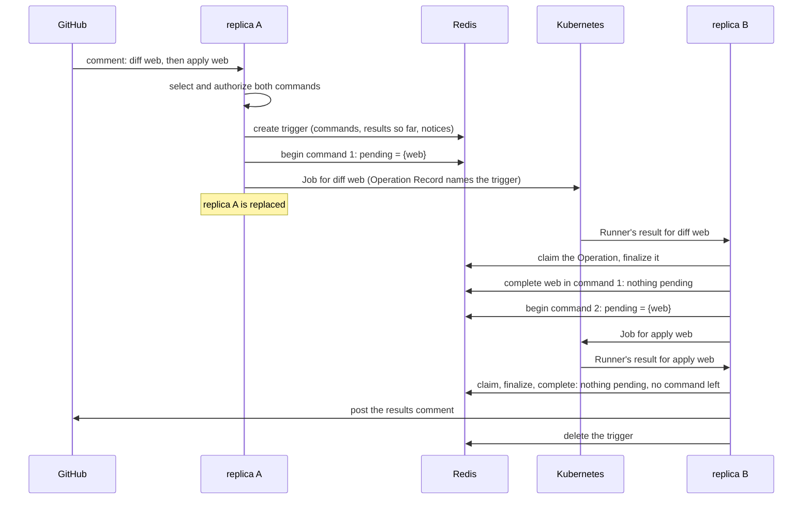
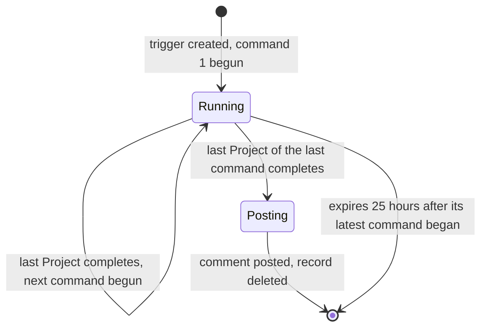

# Design

## Context

See `proposal.md` for why, and the two deltas for the behavior. As the
code stands:

- **A trigger lives in a goroutine.** `HandleIssueComment` and
  `handlePlanTrigger` resolve everything, then start one detached
  goroutine that loops over the comment's commands, calls
  `executeTargets` for each, and calls `postResults` at the end. The
  commands still to run, the results gathered and the selection notices
  exist only in that goroutine's variables.
- **Each Operation's dispatcher waits for it.** `executeOne` takes the
  Lock, creates the check and the Operation Record, subscribes to the
  Redis Pub/Sub channel `operation-done:<id>`, creates the Job, and then
  blocks until `HandleResult` or the sweep publishes the result there,
  for up to 24 hours. Pub/Sub has no replay, so a result published when
  the subscriber is gone is lost.
- **Finalization is already replica-independent.** `HandleResult` and
  the sweep claim an Operation Record atomically (a Lua script that sets
  `finalized`), complete the check, move the Lock, record the outcome
  and delete the record. Only the last step, the publish, depends on
  another replica.
- **Any replica can act for any pull request.** A GitHub client is built
  from an installation id, and an Operation Record already carries the
  repository, the pull request and the installation.
- **Shutdown lets open Runner RPCs end**, but does not wait for the
  detached goroutines (`server` capability, Shutdown).

## Goals / Non-Goals

**Goals**
- No replica waits on another: a trigger's next step is taken by
  whichever replica finishes the step before it
- Each command is carried forward by exactly one replica, without any
  lock or leader
- The change stays inside `internal/orchestrator`: no wire, check run,
  Lock or comment format changes

**Non-Goals**
- Recovering a trigger whose replica is killed in the middle of a step
  (see Risks); a trigger is carried across replicas between steps, not
  inside one
- Retrying a comment post that GitHub refused (the proposal's out of
  scope)
- Shortening the 24 hours a started Operation can hold its trigger back
  (`runner-timeouts`)
- Queuing, ordering between Projects, or resuming a queue
  (`operation-scheduling`)

## Flow





## Decisions

### 1. The trigger is one Redis hash

Everything a trigger needs is in one key, `trigger:<id>`, a hash:

| Field | Holds | Written |
|---|---|---|
| `meta` | JSON: the repository (owner, name, id, URL), the installation id, the pull request (number, head commit, base and head refs), the selection notices, and the commands in order, each a list of resolved Targets | once, at creation |
| `command` | the index of the command now running | when a command begins |
| `pending:<command>:<project>` | present while that Project of that command has not completed | set when the command begins, deleted on completion |
| `result:<n>` | one Project's result, as JSON, numbered in the order added | on completion, and at creation for Projects refused during selection |
| `results` | how many results have been added | with each `result:<n>` |
| `completed:<command>:<project>` | the token of the completion that completed that Project, and the answer it was given | with the result |

A Target is what `executeOne` is handed today (the Project, the
operation, the extra arguments, who triggered it, the clone settings),
and an Operation Record already stores a Project as JSON, so `meta`
needs no new encoding.

The key expires 25 hours after its latest command began (the expiry is
set again each time one begins) and is deleted once the comment is
posted.

- **Alternative considered:** one JSON value, read, changed and written
  back by a Lua script, as the Operation Record and the Lock are.
- **Rejected because:** results carry up to 1 MiB of output each, so
  every completion would decode and re-encode megabytes inside Redis,
  and `cjson` turns an empty list into an object on the way back. A hash
  lets a script move a result in as an opaque string.
- **Alternative considered:** a hash, a set for the pending Projects and
  a list for the results.
- **Rejected because:** a script over three keys needs them in one slot
  on a clustered Redis; one key needs nothing.

### 2. A command is finished by whoever removes its last pending field

Every Project of a command gets a pending field before any of that
command's Operations is dispatched. Each then completes exactly once, by
one atomic script:

```lua
-- KEYS[1] = trigger:<id>
-- ARGV[1] = pending field, ARGV[2] = command index, ARGV[3] = result JSON,
-- ARGV[4] = completed field, ARGV[5] = the completion's token
-- Returns -1 when another completion already completed this Project or the
-- trigger is gone, otherwise how many Projects of the command are still
-- pending (the same answer again for a retry with the same token).
if redis.call('HDEL', KEYS[1], ARGV[1]) == 0 then
    local prior = redis.call('HGET', KEYS[1], ARGV[4])
    if prior then
        local sep = string.find(prior, ':', 1, true)
        if sep and string.sub(prior, 1, sep - 1) == ARGV[5] then
            return tonumber(string.sub(prior, sep + 1))
        end
    end
    return -1
end
local n = redis.call('HINCRBY', KEYS[1], 'results', 1)
redis.call('HSET', KEYS[1], 'result:' .. n, ARGV[3])
local pending = 0
for _, field in ipairs(redis.call('HKEYS', KEYS[1])) do
    if string.sub(field, 1, #ARGV[2] + 9) == 'pending:' .. ARGV[2] .. ':' then
        pending = pending + 1
    end
end
redis.call('HSET', KEYS[1], ARGV[4], ARGV[5] .. ':' .. pending)
return pending
```

Each completion carries a random token, the same on every try of it.
The completion that removes the pending field records its token and its
answer in `completed:<command>:<project>`. A try whose answer was lost
(the connection broke after Redis ran it, or the Redis client retried
on its own) is given that answer again, so the completion that finished
the command still learns it did. Any other token is answered -1 (added
at implementation, task 7.1).

The one completion that is returned 0 carries the trigger forward. Two
replicas completing the last two Projects at the same moment run the
script one after the other, so exactly one sees 0: that is the spec's
"exactly one replica", with no lock.

Who completes a Project:

| What happened to the Project | Who completes it | With |
|---|---|---|
| refused before a Job existed (its Lock, an override, a failed check, Job build or create) | the replica dispatching the command | the refusal, as today |
| its Runner reported | the replica that finalized the result | the result |
| its Runner never started | the sweep that timed it out | the diagnostic |
| started and silent for 24 hours | the sweep that abandoned it | `No result was received from the Runner within 24 hours.` |

A command all of whose Projects are refused is therefore finished by
the dispatching replica itself, as soon as its dispatch ends, which is
the spec's "a command with nothing dispatched".

The command index is part of the pending field because one Project can
be in two commands of a comment (`diff web`, then `apply web`).

- **Alternative considered:** a counter of outstanding Operations,
  decremented on completion.
- **Rejected because:** a completion delivered twice would count twice
  and finish a command early. Deleting a named field can only succeed
  once.

### 3. Dispatch no longer waits

`executeOne` ends when the Job is created. Its second half (the
subscription, the wait, the 24-hour bound) and `notify.go` go away, and
the Pub/Sub channel `operation-done:<id>` with them. The Operation
Record gains the trigger's id and the command's index, which is all a
finalizer needs to complete the Project.

Two things that hung off the wait move to finalization, which has the
record's creation time: the operation-duration metric, and the
`operation finished` log line with its outcome.

A trigger that dispatches nothing (every Project refused during
selection) posts its comment at once and creates no record, as the spec
allows ("every trigger that dispatches an Operation").

### 4. The finalizer carries the trigger forward itself, before it returns

The replica that is returned 0 begins the next command and dispatches
it, or posts the comment, inside the call that finalized the Operation:
the Runner's `ExecuteOperation` RPC, or the sweep's tick.

- **Alternative considered:** hand the next step to a background
  goroutine and acknowledge the Runner at once.
- **Rejected because:** shutdown lets open Runner RPCs end and waits for
  nothing else. Work done inside the RPC is finished before a replica
  told to stop goes away; work in a goroutine is the loss this change
  exists to remove. The cost is that a Runner's Pod stays until the next
  command's Jobs are created or the comment is posted, seconds in
  practice.

A Runner whose acknowledgment is lost sends its result again; the
Operation is already claimed, so the second delivery is ignored, as
today.

### 5. The comment is posted at most once

Posting is the step taken on 0 when no command is left: read `meta` and
every `result:<n>` in order, build and post the comment with
`postResults` as today, then delete the key. Only one replica is ever
returned 0 for the last command, so only one posts.

Nothing posts it a second time. If that replica is killed between being
returned 0 and GitHub accepting the comment, the comment is lost (see
Risks).

- **Alternative considered:** post first and mark the trigger posted
  after, with the sweep posting for any finished trigger left unmarked.
- **Rejected because:** it can post twice (a comment in several bodies,
  half posted when the replica dies, is posted again whole), and the
  spec says once. A duplicate needs the same narrow failure a loss does.

### 6. The sweep abandons, and records outlive it by an hour

The claim script gains a third mode beside `result` and `timeout`:
`abandon`, which succeeds only for a record marked started whose
creation was at least 24 hours ago. The sweep tries it for every record
it scans, and an abandoned Operation is completed in its trigger with
the spec's line; its check and its Lock are left as they are.

Operation Records and trigger records expire after 25 hours, an hour
past the abandonment, so the sweep always finds a record to abandon
before Redis removes it.

### 7. A record with no trigger is finalized and nothing more

A finalizer whose Operation names no trigger, or a trigger Redis no
longer has, does everything else (check, Lock, outcome, record) and
logs that there was no trigger to add the result to. That covers a
trigger that expired, and Operations dispatched before this change (see
Migration).

### 8. A step Redis fails is tried again (added at implementation)

The review of the implementation found a case the Risks did not cover: a
Redis error, not a killed replica, in the middle of a step. By then the
Operation is claimed and its record deleted, so nothing else would ever
complete its Project. Each step of a trigger against Redis (creating
it, beginning a command, completing a Project, reading it back, deleting
it) is therefore tried up to 4 times, waiting 250 ms, 500 ms and 1 s
between tries, under two seconds in all.

A completion that Redis ran but whose answer was lost is given that
answer again on the next try, by the token in Decision 2's script.

When the trigger cannot be created at all, nothing is dispatched and
the results comment is posted at once: the Projects refused during
selection, every other Project as refused with `recording the trigger:
<error>. Nothing was dispatched; comment again to retry.`, and the
notices. Before this change the same Redis failure still produced a
comment, each Project refused at its own Lock.

- **Alternative considered:** no retry, as first designed.
- **Rejected because:** a Redis failover of a second or two would cost
  a trigger its comment and its later commands, the loss this change
  exists to remove, without any replica going away.

## What moves in the code

| Today | After |
|---|---|
| `HandleIssueComment`, `handlePlanTrigger`: a goroutine loops over the commands and posts | create the trigger, begin its first command in a goroutine, return |
| `executeTargets`: dispatch and wait for all | begin a command: set its pending fields, dispatch concurrently, complete each refusal |
| `executeOne`: Lock, check, record, subscribe, Job, wait | the same up to the Job |
| `HandleResult`, the sweep: finalize, publish | finalize, complete the Project in its trigger, carry the trigger forward on 0 |
| `notify.go` | removed |
| the claim script: `result`, `timeout` | plus `abandon` |

## Verification

| What | How |
|---|---|
| Exactly one caller carries a command forward | property: for any number of Projects completed concurrently in any order, exactly one completion returns 0, and every result is stored once |
| A completion delivered twice | the second returns -1 and adds nothing |
| The receiving replica is gone | two orchestrators on one Redis: the first dispatches `diff` then is dropped, the second receives the result, dispatches `apply`, receives its result and posts one comment carrying both |
| Every replica replaced | the spec's self-upgrade scenario: a result delivered to an orchestrator that dispatched nothing still posts the comment |
| A command with nothing dispatched | every Project of the first command refused at its Lock: the second command is dispatched at once |
| Abandonment | a started record 24 hours old is claimed by `abandon`, its trigger gets the line, its check and Lock are untouched; a result that arrives after is ignored |
| No trigger | a record naming a missing trigger is finalized without error |

The orchestrator's property tests already run against a real Redis; the
two-orchestrator tests use the same harness.

## Risks / Trade-offs

A trigger survives a replica going away between steps. It does not
survive a replica killed inside one, and nothing recovers it then: the
trigger expires after 25 hours without a comment. The steps and what
protects each:

- [A replica is killed while dispatching a command, so some Projects
  never get a Job and never complete] → dispatch is seconds long.
  Carried forward inside a Runner's RPC it is covered by shutdown, which
  lets that RPC end. The first command's dispatch runs in the
  background after the webhook is answered, and a replica told to stop
  in those seconds loses it, as it loses the whole trigger today.
- [A replica is killed after claiming an Operation and before completing
  it in its trigger] → inside the Runner's RPC or the sweep's tick, so a
  stop waits for it; only a kill (out of memory, a lost node) reaches
  it. The check and the Lock are already moved, so the pull request is
  right and only the comment is missing.
- [A replica is killed between being returned 0 and posting] → the same
  protection, and the same result.
- [The next command is dispatched inside a Runner's RPC, which holds
  that Runner's Pod] → for as long as creating the next command's Jobs
  takes. A very large command would be better begun in the background;
  that belongs with `operation-scheduling`, which changes how a command
  is dispatched anyway.
- [A started Operation that never reports holds its trigger's later
  commands and its comment for 24 hours] → as today; `runner-timeouts`
  shortens it.
- [GitHub refuses the comment] → logged, as today; the trigger is
  deleted and the comment is not retried (out of scope).
- [This change, `operation-scheduling`, `fix-concurrent-mutations` and
  `runner-timeouts` all touch dispatch and finalization] → this one
  lands first: the others build on the trigger record and the claim
  modes it adds.

Recovering a trigger stranded by a kill is possible (the sweep could
compare each trigger's pending Projects with the Operation Records
still alive, and complete the ones with none), and is left out: it adds
a second writer for every completion, and a spec for what the comment
says about a Project nobody finished, to cover failures that need a
kill inside a window of seconds.

## Migration Plan

None is built. Operations in flight when the Server is upgraded to this
change were dispatched without a trigger: they are finalized (check,
Lock, outcome) and their triggers' comments are not posted, once. Upgrade
when nothing is running, or expect to re-read the checks of what was.
