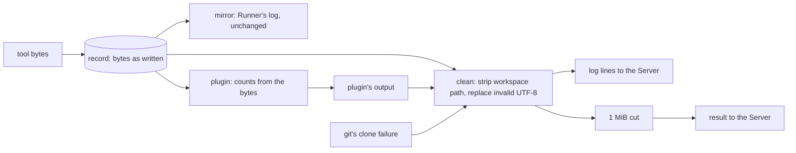

# Design

## Context

See `proposal.md` for why, and the delta for the behavior. As the code
stands:

- **One step prepares text for the Server.** `runner.execute` builds a
  `clean` function, today `stripWorkspacePath` alone, and passes every
  string bound for the Server through it: each log line (the reporter's
  sender and its replay call it), the result's output and its error
  message. The result's output is cleaned before the 1 MiB cut, so the
  cut measures what is sent.
- **The clone container is the exception.** `RunClone` calls
  `stripWorkspacePath` itself on its failure message.
- **Nothing upstream of that step changes text.** The record holds the
  tool's bytes as written; the mirror writes them to the Runner's log
  and the plugin reads its counts from them.
- **The cut already respects characters.** When the 1 MiB cut lands
  inside a line, it moves to the next rune start, so a valid string
  stays valid.
- **Go's protobuf refuses to encode a `string` field holding invalid
  UTF-8.** The send fails before anything reaches the wire, on every
  attempt, which is the bug.

## Goals / Non-Goals

**Goals**
- Nothing the Runner sends can fail to encode for its text
- One place does it, so a new string bound for the Server cannot miss it

**Non-Goals**
- Changing the record, the mirror or the counts (they keep the bytes)
- Reporting that a tool printed invalid UTF-8
- Text from anywhere but the Runner (the Server's own comments and
  checks are built from valid strings)

## Flow

## Decisions

### 1. The existing cleaning step does it

`stripWorkspacePath` becomes the first half of one function that every
string bound for the Server already passes through; the second half is
`strings.ToValidUTF8(s, "�")`, which replaces each maximal run of
invalid bytes with one U+FFFD, exactly the delta's rule. `execute`'s
`clean` and `RunClone`'s failure message both call that one function, so
the clone path stops being an exception.

The replacement runs after the path is stripped. The order does not
change the result (the workspace path is ASCII, and no replacement can
create or break one), but it makes the function's last word the
guarantee: whatever it returns is valid UTF-8.

- **Alternative considered:** replace in the capture, as lines are
  recorded.
- **Rejected because:** the record is the tool's output as written. The
  Runner's log is meant to show those bytes, and the counts must not
  depend on how turnip displays them (the delta's last two scenarios).
- **Alternative considered:** a gRPC client interceptor that repairs
  every outgoing message.
- **Rejected because:** it would run after the 1 MiB cut, so the limit
  would no longer measure what is sent, and repairing a whole message's
  fields there means knowing which ones are text, which the cleaning
  step already does by construction.

### 2. The limit, and the size the Runner logs, are of the replaced text

A replacement can grow the text: one invalid byte becomes the three
bytes of U+FFFD. Because cleaning happens before the cut, the 1 MiB
limit applies to the replaced text, as the delta says, and the result
always fits. `output_bytes` in the Runner's result log line is the
cleaned output's size, as it is today with paths stripped; a run with no
invalid bytes reports exactly what it did before.

## Verification

| What | How |
|---|---|
| The function's guarantee | property: for any byte string, the cleaned text is valid UTF-8, valid input comes back unchanged apart from the stripped path, and each run of invalid bytes becomes one U+FFFD |
| Every path uses it | tests for a log line, the result's output, its error message and a clone failure, each holding invalid bytes, asserting the text sent |
| The bug is gone end to end | an in-process checkpoint like the large-output one: a stand-in `helmfile` printing invalid bytes, run by `runner.Run` against a Server from `rpc.NewServer`, delivers its log lines and its result on the first attempt |
| What keeps the bytes | the Runner's log shows them; a `diff` whose only body line is invalid still counts the release |
| The limit | a 3 MiB output full of invalid bytes is sent at no more than 1 MiB, and still valid |

Property tests are tagged `// Feature: fix-invalid-utf8-output,
Property <n>: <name>`.

## Risks / Trade-offs

- [A reviewer sees `�` where the tool printed something] → the bytes
  were not text a comment could show; the Runner's log has them, and
  the live view will show the same `�` as the comment.
- [Text in another encoding (Latin-1 file contents) loses its accented
  characters] → shown as `�`, never as a failed delivery; converting
  encodings is not turnip's to guess.

## Migration Plan

None. Valid output is sent exactly as before.
