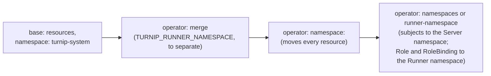

# Design

## Context

`deploy/base` sets no namespace today: every resource lands where the
install targets, and the Server creates Runner Jobs in
`TURNIP_K8S_NAMESPACE` (`default`). The specs give the base one
namespace (`turnip-system`) that the Server and its Runner Jobs share,
and let the operator rename it and separate a Runner namespace from it,
with every value that names one following the choice.

Revised 2026-10-19: the first design preset
`TURNIP_RUNNER_NAMESPACE=turnip-runners` in the base, so a first install
failed until a second namespace existed. The base now leaves it unset, and separating the namespaces is
the operator's step, which the docs recommend.

Kustomize decides most of this design, so its behavior was tested
(`kubectl` 1.33, Kustomize 5.6) before choosing anything:

| Behavior | Observed |
|---|---|
| A kustomization's `namespace:` | sets the namespace of every namespaced resource below it, including resources whose namespace is already set |
| Binding subjects under `namespace:` | renamed only while the ServiceAccount they name is in the same build and the binding shares its namespace; a subject in a binding of another namespace, or one left as `default` with no ServiceAccount in the build, is not renamed. The current base's ClusterRoleBinding comment claiming otherwise is wrong |
| Order within one kustomization | resources, then components, then this kustomization's generators (a `behavior: merge`), then `namespace:` and the other built-in transformers, then `replacements` and `transformers:` |
| A component's `replacements` | run before the parent's merge and `namespace:`, so they see neither |
| `transformers:` entries | may be a remote kustomization directory (`github.com/...//dir?ref=`) whose resources are transformer configs |
| An operator's `behavior: merge` into a base ConfigMap the base namespaced with its own `namespace:` | works without naming the namespace |
| A replacement whose source field is absent | fails the build (`fieldPath ... is missing for replacement source`) |
| An operator `namespace:` over a base whose subjects already name `turnip-system` | moves the bindings but leaves both subjects at `turnip-system` |

## Goals and non-goals

- One namespace and no setting for a first install.
- One source of truth per namespace: Kustomize's `namespace:` for the
  Server's, the `TURNIP_RUNNER_NAMESPACE` value for the Runners'.
- An omitted `TURNIP_RUNNER_NAMESPACE` means the Server's own namespace.
- Non-goal: per-repository Runner namespaces, and any Server code beyond
  the setting's rename, its default and its startup log line.

## Where each resource lands

| Resource | Namespace | Set by |
|---|---|---|
| Deployment, Service, ServiceAccount `turnip-server` | Server | the base's `namespace: turnip-system`, or the operator's `namespace:` |
| ConfigMap `turnip-server-config` | Server | same |
| Secret `turnip-github-app` (the operator's) | Server | the operator's `namespace:` |
| Role and RoleBinding `turnip-server` | Runner: the Server's by default, or `TURNIP_RUNNER_NAMESPACE` once separated | `namespace:` by default; the `runner-namespace` transformer once separated |
| Subjects of the RoleBinding and of the ClusterRoleBinding `turnip-server-token-review` | Server | the base (`turnip-system`), or either transformer from the ServiceAccount's namespace |
| ClusterRole, ClusterRoleBinding | none (cluster-scoped) | |
| `TURNIP_RUNNER_SERVER_ADDR` | Server, in its value | the Pod itself, at start (Downward API) |

## Decisions

### 1. Two transformers: one renames, one separates

Two kustomizations, each holding a `ReplacementTransformer`:

| Transformer | Source | Targets |
|---|---|---|
| `deploy/transformers/namespaces` | ServiceAccount `turnip-server`, `metadata.namespace` | the `turnip-server` subject's `namespace` in RoleBinding `turnip-server` and ClusterRoleBinding `turnip-server-token-review` |
| `deploy/transformers/runner-namespace` | the above, plus ConfigMap `turnip-server-config`, `data.TURNIP_RUNNER_NAMESPACE` | the above, plus `metadata.namespace` of Role and RoleBinding `turnip-server` |

`runner-namespace` includes `namespaces` rather than repeating it, so an
operator lists exactly one of them. They are separate because a
replacement whose source field is absent fails the build: one
transformer reading `TURNIP_RUNNER_NAMESPACE` could not serve an
install that leaves it unset.

The base sets `namespace: turnip-system`, names `turnip-system` in both
subjects, and lists neither transformer: it renders correctly on its
own (the release manifest, `make manifests-check`). An operator's later
`namespace:` moves every resource but leaves the subjects behind, and
that is what `namespaces` fixes; separating the Runner namespace also
needs the Role moved back out, which is what `runner-namespace` adds.
Both run after the operator's `namespace:` and ConfigMap merge.



- **Alternative considered:** the base presetting
  `TURNIP_RUNNER_NAMESPACE=turnip-runners`, separated out of the box
  (this design's first version). **Rejected because:** a first install
  then fails until a second namespace exists, against the rule that the
  defaults alone get turnip running; the docs recommend separating
  instead.
- **Alternative considered:** shipping the replacements as a Kustomize
  component, which an operator also adds in one line.
  **Rejected because:** tested, a component runs before the operator's
  own merge and `namespace:`, so it reads the base's Runner namespace
  and is then undone by the rename.
- **Alternative considered:** two bases, one for the Server and one for
  the Runner RBAC, each given its namespace by the operator.
  **Rejected because:** a `namespace:` applies to everything below it,
  so the operator would need two sibling directories under a parent
  that sets none, three files instead of one, and the RoleBinding's
  subject would still not follow the Server namespace.
- **Alternative considered:** explicit namespaces on each resource, and
  patches in the operator's kustomization to rename them.
  **Rejected because:** six or more patches per rename, and forgetting
  one fails only when the Server first creates a Job.
- **Alternative considered:** relying on Kustomize's own subject
  renaming. **Rejected because:** tested, it does not reach a binding in
  another namespace than its ServiceAccount, and it is lost once a
  replacement also targets the binding.

### 2. The operator's kustomization sets `namespace:` and lists one transformer

The documented operator kustomization becomes:

```yaml
namespace: turnip-system
resources:
  - github.com/ivanvc/turnip//deploy/base?ref=vX.Y.Z
transformers:
  - github.com/ivanvc/turnip//deploy/transformers/namespaces?ref=vX.Y.Z
configMapGenerator:
  - name: turnip-server-config
    behavior: merge
    literals:
      - TURNIP_REDIS_ADDR=...
      - TURNIP_GITHUB_APP_ID=...
secretGenerator:
  - name: turnip-github-app
    ...
```

and separating the Runner namespace, which the docs recommend, changes
two lines: `TURNIP_RUNNER_NAMESPACE=turnip-runners` among the literals,
and `deploy/transformers/runner-namespace` in place of `namespaces`.

`namespace:` is there even with the default name: without it, the
operator's generated Secret gets no namespace and lands wherever
`kubectl` points, not beside the Deployment. The transformer is there
even with the default name too, so renaming is a one-word edit rather
than a second step that is easy to miss: with a renamed `namespace:` and
no transformer, both subjects still name `turnip-system` (tested), so
the Server is refused both Jobs and token reviews.

- **Alternative considered:** documenting the transformer only for
  operators who rename. **Rejected because:** forgetting it on a later
  rename fails only at the first Job, far from the edit that caused it;
  listing it from the start costs one line and does nothing until then.

The pilot deploys with Helmfile, which builds a kustomization through
chartify and may apply the release namespace the same way a `namespace:`
does. The transformer line makes either path correct; the pilot deploy
is the check (see Risks).

### 3. The Runner's address comes from the Server Pod's namespace

As the spec states: the container's `env` gains, ahead of the address,

```yaml
- name: POD_NAMESPACE
  valueFrom:
    fieldRef:
      fieldPath: metadata.namespace
- name: TURNIP_RUNNER_SERVER_ADDR
  value: turnip-server.$(POD_NAMESPACE).svc:9090
```

and the ConfigMap stops presetting the address. `env` wins over
`envFrom`, so an address merged into the ConfigMap is ignored; pointing
Runners elsewhere means patching this entry.

- **Alternative considered:** naming the helper `TURNIP_SERVER_NAMESPACE`.
  **Rejected because:** a `TURNIP_` name reads as a Server setting and
  would invite a row in the settings Reference for something the Server
  never reads. `POD_NAMESPACE` is the usual name for this field.

### 4. The startup log names both values

The `server starting` line's `namespace` field becomes
`runner_namespace`, holding the resolved value (Decision 5), and it
gains `runner_server_addr`. The Server image
is distroless, so no one can `exec` in to read the expanded address;
the log is how an operator, and the kind test, see what Runners will
dial.

### 5. Unset, the Runner namespace is the Server's own

When `TURNIP_RUNNER_NAMESPACE` is unset, the Server asks the same
client-go loader it already builds its Kubernetes client with
(`clientcmd`'s deferred loading config) for its namespace. That answer
covers every way the Server runs:

| Where the Server runs | Namespace it resolves |
|---|---|
| In a cluster, `POD_NAMESPACE` set (the base, Decision 3) | `POD_NAMESPACE` |
| In a cluster, no `POD_NAMESPACE` | its ServiceAccount's, from the mounted `namespace` file |
| Outside a cluster (development) | the current kubeconfig context's, or `default` |

`internal/orchestrator` keeps reading only the environment: an unset
value stays empty there, and `cmd/server` fills it in from the loader
before anything uses it, so the Job client and the Runner authenticator
receive one resolved namespace as today. The startup log line
(Decision 4) shows the result.

- **Alternative considered:** keeping the setting required.
  **Rejected because:** an install that runs everything in one namespace
  (the base's default, a quick test, or no Kustomize at all) should not
  have to name the namespace it is already in.
- **Alternative considered:** defaulting to `default`.
  **Rejected because:** that is rarely where the Server or its Role is,
  so an omitted value would fail on the first Job instead of working.

The old name, `TURNIP_K8S_NAMESPACE`, is simply no longer read. A Server
configured only with the old name therefore creates Jobs beside itself.

- **Alternative considered:** refusing to start while the old name is
  set. **Rejected because:** that is upgrade code for one installation;
  its Jobs landing beside the Server is the base's default anyway.

## Verification

| What | How |
|---|---|
| The base renders one namespace, the subjects and no address in the ConfigMap | `make manifests-check` and a Go test over `kubectl kustomize deploy/base`, skipped without `kubectl` (CI installs it) |
| An omitted `TURNIP_RUNNER_NAMESPACE` | unit tests: the loader leaves it empty without error, and `cmd/server` fills it from the namespace source |
| The operator's kustomization: the default, a renamed Server namespace, and a separated Runner namespace | fixture kustomizations under `test/` (local paths in place of the remote refs), rendered and checked |
| The separated layout's RBAC in a real cluster | `make test-kind`: the kind overlay separates `turnip-runners`; the test checks the Server can create Jobs and get Pods there, can do nothing in `turnip-system`, and still cannot read Secrets |
| Cross-namespace reachability and the expanded address | `make test-kind`: a Pod in `turnip-runners` reaches `turnip-server.turnip-system.svc:9090`, and the Server's startup log reports that address |
| The pilot | the owner deploys with Helmfile and the transformer line, and a plan runs |

The kind tests read `TURNIP_TEST_NAMESPACE` today; they move to
`TURNIP_TEST_SERVER_NAMESPACE` and `TURNIP_TEST_RUNNER_NAMESPACE`,
defaulting to `turnip-system` and `turnip-runners`.

## Risks

- **Runners beside the Server by default.** An install that does not
  separate the Runner namespace keeps the exposure this change exists to
  remove: a Runner's grant on its namespace's Secrets or Pods reaches
  the GitHub App's key and the Server Pod. Accepted (2026-10-19) so the
  defaults alone run; the operator docs recommend separating, say what
  sharing exposes next to the setting and in Runner access, and the
  startup log shows the namespace chosen.
- **An operator omits the transformer line, or lists the wrong one.**
  Renaming without it, the Server fails on its first Job with a
  Forbidden error; separating with `namespaces` instead of
  `runner-namespace` leaves the Role in the Server namespace, with the
  same error; `runner-namespace` without `TURNIP_RUNNER_NAMESPACE`
  fails the build, naming the missing field. Mitigated
  by the docs presenting the line as required, and by the startup log
  stating the Runner namespace. A startup permission check (a
  `SelfSubjectAccessReview`) would catch it sooner, and is left out to
  keep Server code unchanged.
- **Chartify's handling of the release namespace is unverified.** If it
  rewrites namespaces after the operator's transformers rather than as
  a `namespace:`, the Role would end up in the Server namespace. The
  pilot deploy checks this before the change is archived.
- **Kustomize's ordering is observed, not documented as a contract.**
  The fixture render test catches a change in a later Kustomize.
