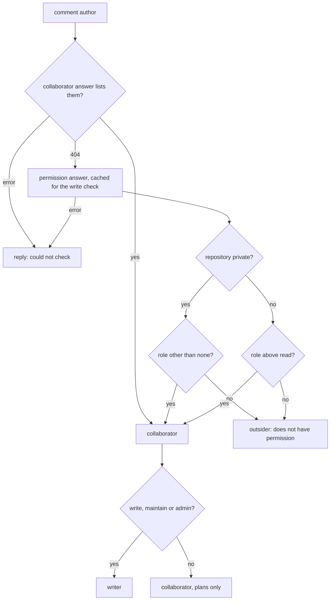

# Design

## Context

See `proposal.md` for why, and the delta for the behavior. As the code
stands:

- **`github.Authorizer` holds two separate answers per account**, each
  fetched at most once per comment and kept for 5 minutes:
  `IsCollaborator` (the 204/404 collaborator endpoint) and the
  permission level behind `HasWritePermission` (the permission
  endpoint). Its `cacheEntry` comment says inferring the first from the
  second "is the defect this shape exists to make unexpressible".
- **Three places refuse, and each folds an error into a refusal**: the
  comment gate (`HandleIssueComment`), the write check for a mutating
  command (`target.go`), and the unlock (`handleUnlock`). A fourth
  caller, the mutation requirement gate, asks whether a reviewer is a
  writer; it already uses the permission endpoint, so team access
  already counts there.
- **The permission endpoint reports two fields.** `permission` is
  GitHub's legacy base role (admin, write, read, none), with maintain
  folded into write and triage into read. `role_name` is the highest
  role from every grant, teams included, and may be a custom role's
  name. turnip reads only `permission` today.
- **`github.Repository` carries no visibility.** The webhook payload
  has `repository.private`; `repositoryFrom` does not read it.

## Goals / Non-Goals

**Goals**
- A team-granted collaborator passes the gate, with the App's current
  permissions
- The visibility rule lives in one function, so the inference the
  `cacheEntry` comment forbids is allowed in exactly one, reviewed form
- An error is never reported as a refusal

**Non-Goals**
- Organization permissions for the App
- Changing which roles may trigger what
- Custom repository roles beyond their base role (see Risks)

## Flow



## Decisions

### 1. The Authorizer decides collaborator status, given the visibility

`IsCollaborator` takes the repository's visibility and applies the
rule itself:

```go
// IsCollaborator reports whether username is a collaborator on
// owner/repo: listed by GitHub's collaborator answer, or holding a role
// the repository's visibility does not explain.
func (a *Authorizer) IsCollaborator(ctx context.Context, owner, repo, username string, private bool) (bool, error)
```

It asks the collaborator answer first and stops on a yes, so an
account admitted today costs no extra call. On a 404 it asks the
permission answer, through the same cache the write check reads, so a
team member who then asks for an apply is still asked about once per
comment, as "Permission answers per comment" requires.

The `cacheEntry` comment is rewritten to say what is now true: the two
answers stay separate, and the only place one informs the other is this
function, under the visibility rule.

- **Alternative considered:** a `Role` method returning outsider,
  collaborator or writer, replacing both checks.
- **Rejected because:** the gate needs only collaborator status, and
  asking the permission answer for every author up front would add a
  call for everyone the collaborator answer already admits.

### 2. The role is read from `role_name`, falling back to `permission`

The visibility rule needs triage and read told apart on a public
repository, which the legacy `permission` field folds together. The
permission lookup therefore returns `role_name` when it is one of
GitHub's five standard roles, and `permission` otherwise, which is the
case for a custom role: its legacy field is the base role it extends.

Writers are unaffected: maintain and admin rank at or above write in
either field, so the write check gives the same answers as today.

- **Alternative considered:** keep `permission` alone.
- **Rejected because:** a triage grant through a team on a public
  repository would read as the `read` every account has, and the
  delta's triage scenario would fail.

### 3. Visibility comes from the webhook, and fails strict

`github.Repository` gains `Private`, filled by `repositoryFrom` from the
payload. Only a payload whose `visibility` is `private` (and whose
`private` is true) reads as private. An internal repository on GitHub
Enterprise also sends `"private": true`, but every enterprise member
holds read there through the visibility itself, so it takes the public
rule. A payload without the fields reads as public, the stricter of the
two rules, so a missing value never admits anyone extra.

### 4. Each refusal site tells an error from a refusal

The comment gate, the write check and the unlock each keep their
refusal text and gain an error text, the three the delta fixes. The
error is logged as today. The mutation requirement gate already reports
a reviewer lookup it could not make in its own terms and is left as it
is.

## Verification

| What | How |
|---|---|
| The rule | a table test over the collaborator answer (yes, no, error), visibility (private, public) and every role (none, read, triage, write, maintain, admin, a custom role over each base), against the delta's rule |
| No extra call | a counting fake client: a listed author makes one call; a team writer who plans and then applies makes two in all |
| `role_name` | the lookup prefers a standard `role_name` and falls back to `permission` for a custom role |
| Visibility | the webhook sets `Private` from the payload, and a payload without it reads as public |
| The replies | each of the three error texts, and that each refusal text is unchanged |
| End to end | an orchestrator test: a team writer (collaborator 404, permission write, private) comments `diff` then `apply`, and both run |

## Risks / Trade-offs

- [A custom role granted only through a team, on a public repository,
  based on triage] → its legacy base role reads as `read` and its name
  is not a standard one, so it is refused. Rare; it can be granted
  directly instead.
- [GitHub changes what the collaborator answer leaves out] → the
  permission answer still decides, so turnip admits the same accounts
  either way.
- [An account the collaborator answer omits for a reason other than a
  team, with access GitHub reports] → it is admitted, which is the
  point: the permission answer is what GitHub actually grants.

## Migration Plan

None. Everyone admitted today is still admitted.
