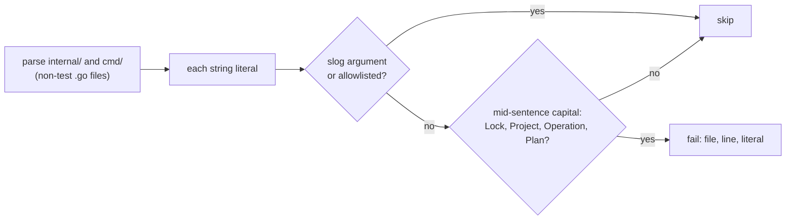

# Design

## Context

The change itself is wording: about fifteen string literals in
`internal/github`, `internal/orchestrator` and `internal/metrics` lose a
capital, the tests asserting them follow, and two troubleshooting pages
quote the new text. No behavior, structure or wire format changes, so
most of this design is the one decision that is not wording: how to
keep `CLAUDE.md`'s rule ("new ones shouldn't add any") from being broken
again the way it was, by copying a sentence from spec prose, where the
capitals are correct, into code, where they are not.

## The strings

The proposal's table is the full list, with each string before and
after. Where each lives:

| File | Strings |
|---|---|
| `internal/github/comment.go` | the scope note below a mutating command's sections |
| `internal/orchestrator/pullrequest.go` | the close comment's heading |
| `internal/orchestrator/execute.go` | the running summary; the check-run failure note |
| `internal/orchestrator/lockstate.go` | four "This Project is free" lines, three "The Lock is still held" lines |
| `internal/orchestrator/sweep.go` | "No Job/Pod found for this Operation"; "This Project mounts keys" |
| `internal/metrics/metrics.go` | two metrics' help text |

A metric's help text is metadata: renaming words in it changes no metric
name or label, so no query or dashboard breaks.

## Decisions

### 1. A test guards rendered string literals

A new test, `test/style/capitalization_test.go`, parses every non-test
Go file under `internal/` and `cmd/` and fails on any string literal in
which "lock", "project", "operation" or "plan" (singular, plural or
possessive) is capitalized after a lowercase letter or a `,`, `;` or `:`
and a space, that is, mid-sentence. A capital at the start of a
sentence ("Lock released: ...") does not match. The test names each
offending literal with its file and line, so the failure says what to
fix.

It skips literals that are not rendered text:

| Skipped | Why |
|---|---|
| Arguments of `slog` calls (`Info`, `Warn`, `Error`, `Debug` and their `Context` forms) | log messages and attribute keys are for operators reading logs, not text turnip renders |
| An allowlist in the test, each entry a file and literal with a one-line reason | a literal the shapes above miss: today only the label `retryTrigger` logs (`"completing a Project"`, in `carry.go`) |

Everything else counts as rendered: comment and check-run text, refusal
and error messages (`fmt.Errorf`, `errors.New`), and metrics' help text.
When this change lands, the test passes with no allowlist entry beyond
log-only labels; after that, a new capitalized string fails `make test`.

- **Alternative considered:** a `golangci-lint` rule. **Rejected
  because:** no bundled linter checks the words inside a string literal
  with this context (mid-sentence, not a log call), and a custom
  analyzer means building and pinning a linter plugin, more machinery
  than one test file.
- **Alternative considered:** relying on review and `CLAUDE.md`.
  **Rejected because:** that is how the strings arrived: each was
  written from spec prose, where the capitals are right, and passed
  review there. A test turns the rule into a failing build at the line
  that breaks it.
- **Alternative considered:** checking the rendered output (comments
  and check runs as the tests capture them) instead of the literals.
  **Rejected because:** it only covers the paths some test happens to
  render, and a string built from fragments would need its own
  assertion; the literals are where every rendered string starts.

### 2. Only these four nouns

The test checks lock, project, operation and plan, the nouns
`CLAUDE.md`'s rule names, and nothing else. "Server" and "Runner" are
the names of turnip's components and stay capitalized; `Job`, `Pod` and
`Secret` are Kubernetes kinds. A wider rule (every capitalized noun
mid-sentence) would catch those and need an allowlist larger than the
problem.

## Out of scope

- The Grafana dashboard's panel titles capitalize these nouns only at a
  title's start, which the rule allows. One title is in Title Case
  ("Runner Job Start Latency (p99)"), a different inconsistency, left
  as it is.
- Documentation prose: the rule is about rendered text, and the docs
  that quote a changed string are updated as part of this change.

## Verification

| What | How |
|---|---|
| Each string | the existing tests asserting a changed string, updated to the new wording (`repository_secrets_test.go` among them), plus the tests that render the lock-transition lines and the close comment |
| The guard | `test/style` passes on the changed tree; a deliberately capitalized literal in a scratch file makes it fail naming file and line; a `slog` message with "Project" does not |
| The docs | `make docs-check`; `docs/using/troubleshooting.md` and `docs/operating/troubleshooting.md` quote the new wording |

## Risks

- **A false positive in an unrendered literal.** A map key, a test
  fixture name in non-test code, or a log label passed through a
  helper. The allowlist takes it, with a reason, and keeps the decision
  visible in review.
- **A false negative in a string built from fragments.** "this " +
  `noun` + " is free" escapes a literal check. turnip builds its
  messages from whole literals today; the test cannot see the rest, and
  review still can.
