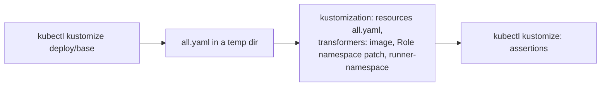

# Design

## Context

Revised 2026-11-03 (proposal Decisions 3 to 5): the first version kept
a fixed-name ConfigMap in the base for the operator to patch; the base
now ships none. Decisions 1 and 5 to 8 below are the revision's.

The specs settle the rule: settings in `turnip-server-config`, secret
material in one Secret, `turnip-server-secrets`, and no Deployment patches. Two
facts of the current base stand in the way:

- `turnip-server-config` comes from a `configMapGenerator` with Kustomize's
  default, a name suffixed with a hash of its contents. Helmfile renders a
  Kustomize chart in two passes, the base first and the release's
  transformers on the result, so by the second pass the name is
  `turnip-server-config-<hash>` and nothing selecting `turnip-server-config`
  finds it (found at the pilot's namespace move, reproduced locally).
- The Deployment reads `turnip-github-app` through two `secretKeyRef`
  entries and mounts nothing, so any other secret (the Redis password
  file) needs an `env` entry, a volume and a mount patched in.

The Server, for its part, ignores a `TURNIP_*` variable it does not read,
silently. The docs reference test (`docs_reference_test.go`) already
proves the settings Reference matches what `ConfigFromEnv` reads, by
recording the names it asks for.

These Kustomize behaviors were checked before choosing (`kubectl` 1.37.1,
Kustomize 5.8.1):

| Behavior | Observed |
|---|---|
| An operator's `configMapGenerator` named `turnip-server-config` | generates `turnip-server-config-<hash>`, and Kustomize rewrites the base's `envFrom` reference to it |
| An operator's `secretGenerator` named `turnip-server-secrets` | generates `turnip-server-secrets-<hash>`, and Kustomize rewrites the base's two `secretKeyRef` entries and the volume's `secretName` to it |
| A `PatchTransformer` setting the Role's namespace, in a kustomization with its own `namespace:` | under `patches:` it runs before `namespace:`, which moves the Role back; under `transformers:` it runs after, and the Role keeps the patched namespace |
| A replacement copying the Role's namespace to the RoleBinding and the container's `TURNIP_RUNNER_NAMESPACE` | works in one pass, and on the rendered base in Helmfile's second pass |

## Where each value lives

| What the operator sets | Where | How it reaches the Server |
|---|---|---|
| Every `TURNIP_*` setting | the operator's ConfigMap `turnip-server-config` (a `configMapGenerator`, or their own resource) | `envFrom` (unchanged) |
| The GitHub App's webhook secret and private key | Secret `turnip-server-secrets`, keys `webhook-secret` and `private-key` | two `secretKeyRef` entries (renamed from `turnip-github-app`) |
| Any other secret (the Redis password) | another key of `turnip-server-secrets` | the whole Secret mounted at `/etc/turnip/secrets`, read through a `_PATH` setting |
| The Server image | Kustomize's `images:` field, or an `ImageTagTransformer` in a Helmfile release | no patch |
| The replica count | Kustomize's `replicas:` field, or a `ReplicaCountTransformer` | no patch |
| The Runner namespace | the namespace of the Server's Role, set by one patch listed under `transformers:` | the `runner-namespace` transformer copies it to the RoleBinding and to the container's `TURNIP_RUNNER_NAMESPACE` |
| The Runner's address for the Server, when not its own Service | a patch of the Deployment's `env` | the one exception the spec keeps |

## Decisions

### 1. The base ships no ConfigMap

`deploy/base` loses its `configMapGenerator`. The Deployment keeps its
`envFrom` reference to `turnip-server-config`, and a comment there
states what the ConfigMap must hold (`TURNIP_REDIS_ADDR`,
`TURNIP_GITHUB_APP_ID`, `TURNIP_RUNNER_IMAGE`) and points at the
settings Reference for the rest. The operator creates it as they create
the Secret:

| Install | ConfigMap | Secret |
|---|---|---|
| Kustomize | `configMapGenerator` (creates; hash-suffixed, and Kustomize rewrites the base's reference) | `secretGenerator` (the same) |
| Helmfile | a release of its own (`incubator/raw`), fixed name | a release of its own, fixed name |
| `turnip-install.yaml` | `kubectl create configmap` | `kubectl create secret` |

Of the old presets, `TURNIP_HTTP_ADDR` and `TURNIP_GRPC_ADDR` become
defaults in `ConfigFromEnv` (Decision 7), `TURNIP_LOG_LEVEL` and
`TURNIP_MINIMIZE_OUTDATED_PLAN_COMMENTS` already defaulted there, and
`TURNIP_RUNNER_IMAGE`'s `:latest` goes, the setting staying required.
The hash suffix comes back for Kustomize installs: a changed setting
renames the ConfigMap and rolls the Deployment by itself.

- **Alternative considered:** the first version of this change, a
  fixed-name ConfigMap in the base for the operator to patch.
  **Rejected because:** it still left two ways to configure turnip
  (patching a base object for settings, creating an object for
  secrets), and none of its presets needed the base.
- **Alternative considered:** an optional ConfigMap reference
  (`optional: true`), so the base starts without one. **Rejected
  because:** the Server cannot start without `TURNIP_REDIS_ADDR` and
  `TURNIP_GITHUB_APP_ID` anyway; a required reference fails at the
  Pod, with the object's name, instead of at the Server's startup.

### 2. One Secret: two keys in the environment, all keys as files

The Deployment's two `secretKeyRef` entries name `turnip-server-secrets` in
place of `turnip-github-app`, and the pod mounts the whole Secret,
read-only, at `/etc/turnip/secrets`. Settings that name a file
(`TURNIP_REDIS_PASSWORD_PATH`, `TURNIP_REDIS_CA_PATH`,
`TURNIP_GITHUB_PRIVATE_KEY_PATH`) point into that directory, so a new
secret needs a key in the Secret and a line in the ConfigMap, never a
patch. A comment where the base references the Secret states its name,
its two required keys, and the mount path for the rest.

- **Alternative considered:** `envFrom` with a `secretRef`, keys named
  after the settings (`TURNIP_GITHUB_WEBHOOK_SECRET`, ...).
  **Rejected because:** a password read from the environment cannot be
  rotated without a restart, where `TURNIP_REDIS_PASSWORD_PATH` re-reads
  its file for each new connection; and the Secret's keys would have to
  be setting names, which an operator generating it from files would
  have to rename.
- **Alternative considered:** a projected volume listing each key the
  Server may read, optional ones marked optional. **Rejected because:**
  the base would need a new line for each future secret, which is the
  patch-per-secret this change removes; mounting the whole Secret costs
  nothing the environment does not already expose, since its two
  required keys are in the environment today.

### 3. `enableServiceLinks: false`

Kubernetes injects variables for every Service in the pod's namespace,
named after it: `turnip-server` gives `TURNIP_SERVER_SERVICE_HOST`,
`TURNIP_SERVER_PORT` and more, and an operator's `turnip-redis` gives
`TURNIP_REDIS_PORT`, which reads like a mistyped setting. The Server
uses none of them (it reaches nothing through them), so the base turns
them off, and the warning (Decision 4) need not explain them away in
the base's own install. The warning still leaves out names of that
shape, for installs that do not use the base.

### 4. The known settings are a list in code, checked by the existing test

`internal/orchestrator` gains the list of every setting it reads:

```go
// SettingNames is every TURNIP_* variable the Server reads, in the
// settings index's order. docs_reference_test.go checks it against both
// what ConfigFromEnv reads and the settings Reference.
func SettingNames() []string
```

`cmd/server`, once settings load, compares the environment's `TURNIP_*`
names against it and logs one warning, `unknown settings`, with the
unknown names, leaving out the Service-variable shapes the spec lists.
The existing docs reference test gains an assertion that
`SettingNames()` equals the names it records `ConfigFromEnv` reading, so
the list, the code and the Reference cannot drift apart.

- **Alternative considered:** recording, at startup, which names
  `ConfigFromEnv` actually read, and warning about the rest.
  **Rejected because:** `ConfigFromEnv` reads some settings only on some
  paths: with `TURNIP_GITHUB_PRIVATE_KEY_PATH` set, which takes
  precedence, `TURNIP_GITHUB_PRIVATE_KEY` is never read, so a set and
  valid setting would be reported as unknown. The test can drive every
  path; startup sees only one.

### 5. The Helmfile recipe, and a test that builds it as Helmfile does

`docs/operating/deployment.md` gains "Installing with Helmfile": the
ConfigMap and the Secret as two releases of their own (where
Helmfile's templating fills in values), and a `turnip` release whose
chart is `deploy/base` at a pinned ref, with `transformers:` holding an
`ImageTagTransformer` for the Server image and, when separating the
Runner namespace, the Role's namespace patch and the `runner-namespace`
replacement inline, since a release's transformers are inline objects.
The `turnip` release `needs` both object releases.

`test/manifests` gains a two-pass case: render `deploy/base`, write the
result into a temporary directory beside a kustomization that lists it
as a resource and applies a fixture's transformers (the `runner-namespace`
one read from `deploy/transformers/runner-namespace`, so the fixture
cannot drift from what ships), and render that.



### 6. The Runner namespace is the namespace of the Server's Role

The Runner namespace is needed when the manifests are built (to place
the Role and RoleBinding) and when the Server runs (to create Jobs).
With the ConfigMap the operator's own resource, possibly in another
Helmfile release, a transformer can no longer read it during the build,
so the value is stated where the build needs it, and the Server is
told from there:

- The base's container `env` gains `TURNIP_RUNNER_NAMESPACE` with the
  value `$(POD_NAMESPACE)`, after `POD_NAMESPACE`: the Server namespace,
  where the base places the Role.
- `deploy/transformers/runner-namespace` becomes a replacement whose
  source is the Role's `metadata.namespace`, with targets the
  RoleBinding's `metadata.namespace` and that `env` entry's value; it
  still includes `../namespaces` for the subjects.
- To separate, the operator lists under `transformers:` a
  `PatchTransformer` setting the Role's namespace, then the
  `runner-namespace` transformer. Under `transformers:` it runs after
  the kustomization's own `namespace:`; under `patches:` it would run
  before it, and `namespace:` would move the Role back (tested). The
  same two objects work in a Helmfile release's `transformers:`.

A `TURNIP_RUNNER_NAMESPACE` in the ConfigMap is overridden by the
container's `env`, as `TURNIP_RUNNER_SERVER_ADDR` already is; the docs
say so where they list the setting.

- **Alternative considered:** keeping `TURNIP_RUNNER_NAMESPACE` a
  ConfigMap setting and repeating its value in the Role patch.
  **Rejected because:** two places holding one value, the drift that
  broke the pilot's first namespace move.

### 7. Listen addresses default in the Server

`ConfigFromEnv` defaults `TURNIP_HTTP_ADDR` to `:8080` and
`TURNIP_GRPC_ADDR` to `:9090` and drops both from the required list.
They are fixed by the manifests (container ports, probes, the Service,
the Runner's `:9090` address), so a value an operator sets only matters
when they also change those.

### 8. Restarting is documented where it is needed

A Kustomize-generated ConfigMap or Secret restarts the Server by itself
on a change. Where the docs show one created any other way (the
Helmfile recipe, quick install), and in the settings Reference's
introduction, they say to run
`kubectl rollout restart deployment/turnip-server` after a change.

## Verification

| What | How |
|---|---|
| The base | `test/manifests`: no ConfigMap and no Secret rendered; `enableServiceLinks` false; the `envFrom` reference to `turnip-server-config`; both `secretKeyRef` entries and the volume naming `turnip-server-secrets`; the read-only mount; `TURNIP_RUNNER_NAMESPACE` set to `$(POD_NAMESPACE)` after `POD_NAMESPACE` |
| An operator kustomization | the fixtures generate both objects: the generated names appear in `envFrom`, both `secretKeyRef` entries and the volume; the separated fixture's Role and RoleBinding and the Deployment's `TURNIP_RUNNER_NAMESPACE` all read the Runner namespace, with `namespace:` set |
| A Helmfile release | the two-pass case of Decision 5: the image replaced; the Role and RoleBinding in the Runner namespace and the Deployment's `TURNIP_RUNNER_NAMESPACE` matching |
| The defaults | `ConfigFromEnv` with neither address set uses `:8080` and `:9090`; the settings Reference test |
| The warning | unit tests: unknown names are reported once, in order; known names and Service-variable shapes are not; no warning when every name is known; the docs reference test checks `SettingNames()` |
| A real cluster | `make test-kind` creates `turnip-server-secrets` (with a `redis-password` key the test Redis does not need), and checks the Server starts and its log has no `unknown settings` warning |
| The docs | `make docs-check`; every snippet matches a fixture apart from remote refs |

## Risks

- **A Kustomize install loses its restart on a settings change.** Until
  now the hash restarted the Server by itself; after this change a
  merged setting is not live until the operator restarts. Mitigated by
  the docs stating the restart at every change.
- **Renaming the Secret breaks every install once.** `turnip-github-app`
  becomes `turnip-server-secrets`; a Server deployed without the new Secret
  never starts (`CreateContainerConfigError`), which is loud. Pre-1.0,
  with one installation; the owner's steps in the tasks say what to
  rename.
- **The mount exposes every key of `turnip-server-secrets` as a file.** Only to
  the Server's own container, which already holds the App's private key
  in its environment; a key an operator adds for another purpose would
  be readable there too, so the Secret is documented as the Server's
  alone.
