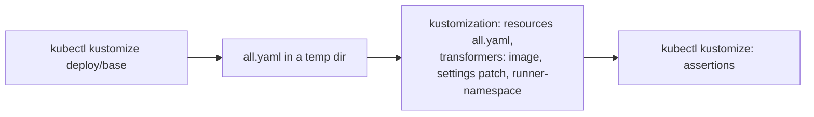

# Design

## Context

The specs settle the rule: settings in `turnip-server-config`, secret
material in one Secret, `turnip-server-secrets`, and no Deployment patches. Two
facts of the current base stand in the way:

- `turnip-server-config` comes from a `configMapGenerator` with Kustomize's
  default, a name suffixed with a hash of its contents. Helmfile renders a
  Kustomize chart in two passes, the base first and the release's
  transformers on the result, so by the second pass the name is
  `turnip-server-config-<hash>` and nothing selecting `turnip-server-config`
  finds it (found at the pilot's namespace move, reproduced locally).
- The Deployment reads `turnip-github-app` through two `secretKeyRef`
  entries and mounts nothing, so any other secret (the Redis password
  file) needs an `env` entry, a volume and a mount patched in.

The Server, for its part, ignores a `TURNIP_*` variable it does not read,
silently. The docs reference test (`docs_reference_test.go`) already
proves the settings Reference matches what `ConfigFromEnv` reads, by
recording the names it asks for.

These Kustomize behaviors were checked before choosing (`kubectl` 1.37.1,
Kustomize 5.8.1):

| Behavior | Observed |
|---|---|
| A generator's `options.disableNameSuffixHash: true` in the base, then an operator's `behavior: merge` into it | the merged ConfigMap keeps the name `turnip-server-config` |
| An operator's `secretGenerator` named `turnip-server-secrets` | generates `turnip-server-secrets-<hash>`, and Kustomize rewrites the base's two `secretKeyRef` entries and the volume's `secretName` to it |
| A patch selecting `turnip-server-config` by name, applied to the rendered base | finds it, and the `runner-namespace` transformer reads it |

## Where each value lives

| What the operator sets | Where | How it reaches the Server |
|---|---|---|
| Every `TURNIP_*` setting | `turnip-server-config` | `envFrom` (unchanged) |
| The GitHub App's webhook secret and private key | Secret `turnip-server-secrets`, keys `webhook-secret` and `private-key` | two `secretKeyRef` entries (renamed from `turnip-github-app`) |
| Any other secret (the Redis password) | another key of `turnip-server-secrets` | the whole Secret mounted at `/etc/turnip/secrets`, read through a `_PATH` setting |
| The Server image | Kustomize's `images:` field, or an `ImageTagTransformer` in a Helmfile release | no patch |
| The replica count | Kustomize's `replicas:` field, or a `ReplicaCountTransformer` | no patch |
| The Runner's address for the Server, when not its own Service | a patch of the Deployment's `env` | the one exception the spec keeps |

## Decisions

### 1. The ConfigMap's name is fixed by a generator option

The base keeps its `configMapGenerator` and gives it
`options.disableNameSuffixHash: true`. Operators' existing
`behavior: merge` keeps working and keeps the fixed name (tested), and
under Helmfile a patch or transformer selecting `turnip-server-config`
by name finds it in the second pass.

What the hash gave is a restart whenever the settings changed; that is
now the operator's `kubectl rollout restart`, as the proposal decided.

- **Alternative considered:** keeping the hash and documenting, for
  Helmfile, patches that select the ConfigMap by a pattern
  (`turnip-server-config-.*`). **Rejected because:** the pilot's
  workaround, and it cannot carry the `runner-namespace` transformer,
  whose replacement source must name its resource exactly; and a
  pattern-selected change no longer restarts the Server either, so the
  hash's one benefit is gone under Helmfile anyway.
- **Alternative considered:** `generatorOptions` for the whole base.
  **Rejected because:** it would also affect any generator added to the
  base later, where a hash may be wanted; the option belongs to this
  one generator.

### 2. One Secret: two keys in the environment, all keys as files

The Deployment's two `secretKeyRef` entries name `turnip-server-secrets` in
place of `turnip-github-app`, and the pod mounts the whole Secret,
read-only, at `/etc/turnip/secrets`. Settings that name a file
(`TURNIP_REDIS_PASSWORD_PATH`, `TURNIP_REDIS_CA_PATH`,
`TURNIP_GITHUB_PRIVATE_KEY_PATH`) point into that directory, so a new
secret needs a key in the Secret and a line in the ConfigMap, never a
patch. A comment where the base references the Secret states its name,
its two required keys, and the mount path for the rest.

- **Alternative considered:** `envFrom` with a `secretRef`, keys named
  after the settings (`TURNIP_GITHUB_WEBHOOK_SECRET`, ...).
  **Rejected because:** a password read from the environment cannot be
  rotated without a restart, where `TURNIP_REDIS_PASSWORD_PATH` re-reads
  its file for each new connection; and the Secret's keys would have to
  be setting names, which an operator generating it from files would
  have to rename.
- **Alternative considered:** a projected volume listing each key the
  Server may read, optional ones marked optional. **Rejected because:**
  the base would need a new line for each future secret, which is the
  patch-per-secret this change removes; mounting the whole Secret costs
  nothing the environment does not already expose, since its two
  required keys are in the environment today.

### 3. `enableServiceLinks: false`

Kubernetes injects variables for every Service in the pod's namespace,
named after it: `turnip-server` gives `TURNIP_SERVER_SERVICE_HOST`,
`TURNIP_SERVER_PORT` and more, and an operator's `turnip-redis` gives
`TURNIP_REDIS_PORT`, which reads like a mistyped setting. The Server
uses none of them (it reaches nothing through them), so the base turns
them off, and the warning (Decision 4) need not explain them away in
the base's own install. The warning still leaves out names of that
shape, for installs that do not use the base.

### 4. The known settings are a list in code, checked by the existing test

`internal/orchestrator` gains the list of every setting it reads:

```go
// SettingNames is every TURNIP_* variable the Server reads, in the
// settings index's order. docs_reference_test.go checks it against both
// what ConfigFromEnv reads and the settings Reference.
func SettingNames() []string
```

`cmd/server`, once settings load, compares the environment's `TURNIP_*`
names against it and logs one warning, `unknown settings`, with the
unknown names, leaving out the Service-variable shapes the spec lists.
The existing docs reference test gains an assertion that
`SettingNames()` equals the names it records `ConfigFromEnv` reading, so
the list, the code and the Reference cannot drift apart.

- **Alternative considered:** recording, at startup, which names
  `ConfigFromEnv` actually read, and warning about the rest.
  **Rejected because:** `ConfigFromEnv` reads some settings only on some
  paths: with `TURNIP_GITHUB_PRIVATE_KEY_PATH` set, which takes
  precedence, `TURNIP_GITHUB_PRIVATE_KEY` is never read, so a set and
  valid setting would be reported as unknown. The test can drive every
  path; startup sees only one.

### 5. The Helmfile recipe, and a test that builds it as Helmfile does

`docs/operating/deployment.md` gains "Installing with Helmfile": one
release whose chart is `deploy/base` at a pinned ref, with
`transformers:` holding an `ImageTagTransformer` for the Server image,
one `PatchTransformer` merging the settings into `turnip-server-config`
(where Helmfile's templating can fill in values), and, when separating
the Runner namespace, the `runner-namespace` replacement inline, since a
release's transformers are inline objects; the Secret is a second
release (or any resource) named `turnip-server-secrets` beside it.

`test/manifests` gains a two-pass case: render `deploy/base`, write the
result into a temporary directory beside a kustomization that lists it
as a resource and applies a fixture's transformers (the `runner-namespace`
one read from `deploy/transformers/runner-namespace`, so the fixture
cannot drift from what ships), and render that.



### 6. Restarting is documented where settings change

Every place the docs show a setting or a secret being changed (the
Kustomize steps, the Helmfile recipe, quick install, the settings
Reference's introduction, Redis and TLS) ends with
`kubectl rollout restart deployment/turnip-server`. Quick install no
longer uses `kubectl set env`, which patches the Deployment: it sets
values in the fixed-name ConfigMap (`kubectl patch configmap`) and
creates `turnip-server-secrets`.

## Verification

| What | How |
|---|---|
| The base | `test/manifests`: the ConfigMap is named `turnip-server-config`; `enableServiceLinks` is false; both `secretKeyRef` entries and the volume name `turnip-server-secrets`; the mount is `/etc/turnip/secrets`, read-only |
| An operator kustomization | the existing fixtures gain a `secretGenerator` for `turnip-server-secrets` with a `redis-password` key: the generated name appears in both `secretKeyRef` entries and the volume, and a merged setting keeps the ConfigMap's fixed name |
| A Helmfile release | the two-pass case of Decision 5: the settings and `TURNIP_RUNNER_NAMESPACE` land in `turnip-server-config`, the Deployment still references it, the image is replaced, the Role and RoleBinding are in the Runner namespace |
| The warning | unit tests: unknown names are reported once, in order; known names and Service-variable shapes are not; no warning when every name is known; the docs reference test checks `SettingNames()` |
| A real cluster | `make test-kind` creates `turnip-server-secrets` (with a `redis-password` key the test Redis does not need), and checks the Server starts and its log has no `unknown settings` warning |
| The docs | `make docs-check`; every snippet matches a fixture apart from remote refs |

## Risks

- **A Kustomize install loses its restart on a settings change.** Until
  now the hash restarted the Server by itself; after this change a
  merged setting is not live until the operator restarts. Mitigated by
  the docs stating the restart at every change.
- **Renaming the Secret breaks every install once.** `turnip-github-app`
  becomes `turnip-server-secrets`; a Server deployed without the new Secret
  never starts (`CreateContainerConfigError`), which is loud. Pre-1.0,
  with one installation; the owner's steps in the tasks say what to
  rename.
- **The mount exposes every key of `turnip-server-secrets` as a file.** Only to
  the Server's own container, which already holds the App's private key
  in its environment; a key an operator adds for another purpose would
  be readable there too, so the Secret is documented as the Server's
  alone.
