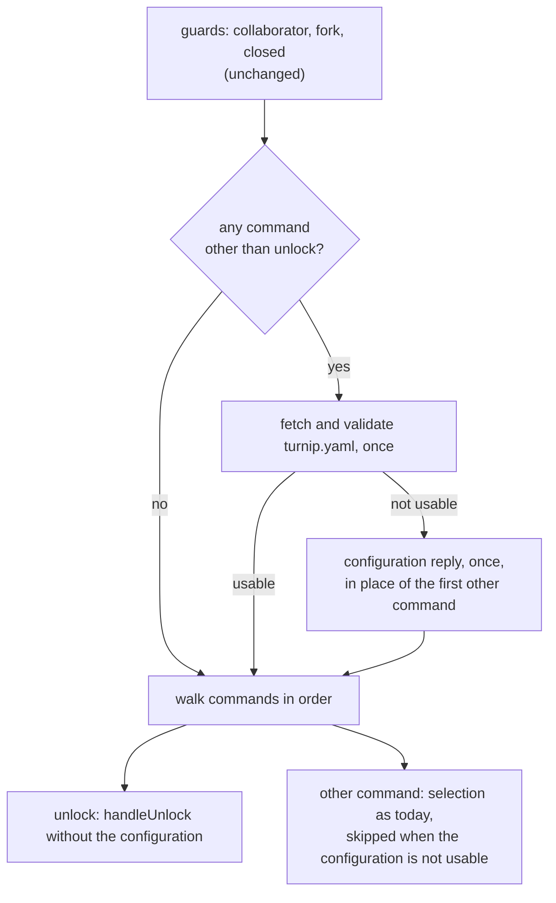

# Design

## Context

A comment reaches `HandleIssueComment`, which runs its guards (the
collaborator check, the fork refusal, the closed-pull-request refusal),
then fetches and validates `turnip.yaml` at the head commit, and only
then walks the comment's commands. A failed fetch posts the
configuration reply and returns, so every command, `unlock` included,
is dropped. `handleUnlock` uses the configuration for one thing:
`resolveUnlockCandidates` turns the trigger word and the named Projects
into a list of configured Projects, whose names build the Lock keys
(`lock:<owner>/<repo>/<project>`).

Nothing in the Lock manager can list Locks today: every method takes
one project key. The specs need two things the configuration used to
supply: the Locks this pull request holds (a bare `unlock`), and the
Lock of a name the configuration may not declare (a named `unlock`).

## Goals and non-goals

- `unlock` never reads the configuration, and the configuration is not
  fetched for a comment that has nothing else to do.
- A named `unlock` and a bare one release exactly what the specs say,
  and a failed read of the Locks releases nothing.
- Non-goal: close handling, which still walks the configuration
  (`fix-lock-release-on-close`, which reuses the listing built here).
- Non-goal: recording a Lock's tool (backlog, decided 2026-10-20).

## The comment path



The configuration fetch moves from "before the loop" to "before the
loop, only if needed". When it fails, the loop still runs: `unlock`
commands are handled, every other command is skipped, and the
configuration reply is placed in the reply list where the first
skipped command's replies would have gone, so replies keep the
command order the `commands` capability requires. Nothing is
dispatched when the configuration was unusable, since every command
that could dispatch was skipped.

One consequence, intended: today a failed fetch returns before the
malformed-line reply is posted, so a comment with a malformed line and
a broken configuration reports only the configuration. Building every
reply in the one list posts both, in the order the `commands`
capability already states.

## Decisions

### 1. Listing a repository's Locks with SCAN

The Lock manager gains one method:

```go
// ListedLock is one Lock found by ListLocks: the project key it is
// stored under and its status, as GetLockStatus would report it.
type ListedLock struct {
	ProjectKey string
	Status     LockStatus
}

// ListLocks returns every Lock whose project key begins with
// keyPrefix, in no particular order. A failure to read any of them
// fails the whole call.
ListLocks(ctx context.Context, keyPrefix string) ([]ListedLock, error)
```

The Redis implementation iterates `SCAN` with the pattern
`lock:<keyPrefix>*` (glob characters in the prefix escaped) and reads
the matches in batches with `MGET`. The orchestrator passes
`<owner>/<repo>/`: the trailing slash keeps repository `api` from
matching `api-v2`, and Project names containing `/` (`gcp/web`) still
fall under it. A key that disappears between `SCAN` and `MGET` (a Lock
released meanwhile) is skipped, not an error.

- **Alternative considered:** an index per pull request, a Redis set of
  its project keys added to when a plan takes a Lock and removed from
  on every release. **Rejected because:** exact and cheap to read, but
  every acquire and release path (each a compare-and-swap script)
  would have to maintain it in the same step, and an index that drifts
  from the Locks is a worse failure than a slow listing. Locks number
  one per locked Project, so a `SCAN` over them is small; Redis is
  never clustered for turnip (the `deployment` capability), so one
  node holds every key.
- **Alternative considered:** reading the base branch's configuration
  instead of the head's. **Rejected because:** it is just as able to be
  invalid, and it misses a Project the pull request added and planned.

### 2. A named unlock reads each named Lock, not the listing

A named `unlock` needs no listing: each name already gives its key.
`handleUnlock` reads every named Lock with `GetLockStatus` first, and
releases only once all reads succeeded, so a failed read releases
nothing, as the spec requires. A bare `unlock` lists with `ListLocks`
and keeps the Locks whose holder is this pull request. Either way the
release itself still goes through `Apply(EventUnlocked)`, the
transition table's path, which also guards the race in which a Lock
changes hands between the read and the release: a Lock another pull
request took meanwhile answers `ErrLockedByOtherPR` and is reported as
held elsewhere, which is true by then.

Names are deduplicated, and compared as written: `*` builds the key
`<owner>/<repo>/*`, which no Lock has, since a Project cannot be named
`*`.

- **Alternative considered:** one code path for both, listing and then
  filtering by name. **Rejected because:** it reads every Lock of the
  repository to answer about one, and it puts a `SCAN` on the path of
  the commonest unlock for nothing.

### 3. The permission check comes first

Today `handleUnlock` resolves candidates before checking write
permission, because the candidates came from the configuration it
already had. With no configuration to resolve against, the write check
moves ahead of reading any Lock, so a refused author causes no Redis
reads at all. The replies for a refused or unchecked author are
unchanged.

### 4. The trigger word is ignored

`resolveUnlockCandidates` and its use of `toolCandidates` go away for
unlock: `/<tool> unlock` and `/turnip unlock` take the same path. The
parser still accepts `unlock` under any trigger word, as today.

## Verification

| What | How |
|---|---|
| `ListLocks` | `internal/lock` tests on miniredis: Locks under the prefix are returned with their status; `api-v2`'s Locks are not returned for `api`; a Project named `gcp/web` is; a key deleted between `SCAN` and `MGET` is skipped |
| A bare unlock | orchestrator tests with the Lock manager: only this pull request's Locks are released and listed; another pull request's Lock goes unmentioned |
| A named unlock | released when held here; listed under held elsewhere when held by another pull request; unmentioned when absent; `*` gets `No projects matched this unlock command.`; a renamed Project's Lock is released |
| A failed read | a Lock manager that fails `ListLocks` or one `GetLockStatus`: no Lock released, the could-not-read reply |
| The configuration | an `unlock`-only comment makes no configuration request to GitHub; an invalid configuration with `unlock` and `diff` posts the unlock reply and one configuration reply, in command order, and dispatches nothing |
| The trigger word | `/helmfile unlock` releases the same Locks as `/turnip unlock` |
| Unchanged guards | `unlock` on a fork's pull request gets no reply; on a closed one, the closed reply |

The orchestrator's fake Lock manager gains `ListLocks`, matching keys
by prefix.

## Risks

- **`SCAN` cost grows with the number of Locks.** Proportional to the
  Locks held across every repository the Server serves, since `SCAN`
  walks the keyspace and filters by pattern. At one key per locked
  Project this stays small for any installation turnip serves today;
  `lock-overview` would need the same listing and can add an index then
  if it ever matters.
- **Listing reads each Lock's stored plan too.** A Lock's value holds
  its plan data beside its status, so `MGET` transfers it although
  `ListedLock` keeps only the status. Bounded by this repository's
  Locks, and only on a bare unlock; if it ever matters, the status can
  move to a key of its own, which no caller here needs to know.
- **A bare unlock races a plan from the same pull request.** A plan
  taking a Lock after the listing is not released by it. The reply
  lists what it released, so the Lock it missed is visible, and a
  second `unlock` releases it.
