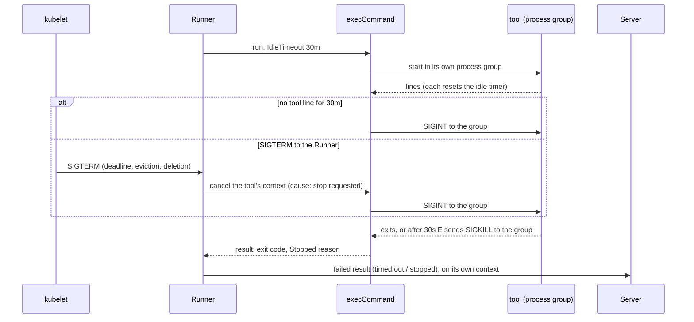
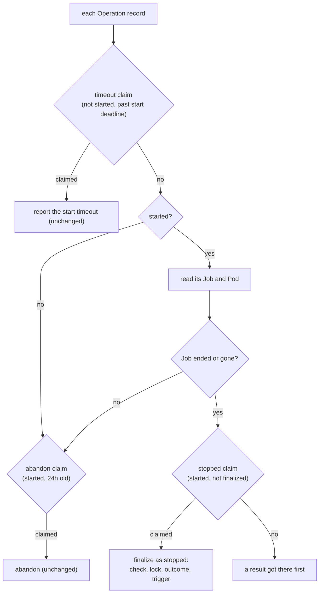

# Design

## Context

Three pieces, on two sides:

| Piece | Where | Today |
|---|---|---|
| The idle timeout | the Runner, around the tool's process | none: `execCommand` (`internal/plugin/command.go`) runs the tool with `exec.CommandContext`, which kills outright on cancellation, and nothing watches output timing |
| Stopping the tool | the same place, and the Runner's signal handling | the Runner forwards no signal; a `SIGTERM` ends the Runner without telling the tool |
| The deadline and the stopped Runner | the Job (`internal/jobs`), and the sweep (`internal/orchestrator/sweep.go`) | no `activeDeadlineSeconds`; the sweep claims an Operation only by its record's timestamps (the start timeout, or abandonment at 24 hours) |

The constraints that shape the design:

- The sweep's claims are Lua scripts deciding on the record alone. "This
  started Runner's Job has ended" is Kubernetes state a script cannot
  see, so the sweep has to read the Job first and claim after.
- Helmfile runs `helm` as child processes. An interrupt sent to the
  `helmfile` process alone leaves its children running, and they are the
  ones holding releases mid-upgrade.
- A Runner told to stop has 60 seconds (the Pod's grace period) to stop
  the tool and still report, so its reporting cannot share the context
  the stop cancels.

## The Runner: watching and stopping the tool



### 1. The stop lives in the command runner, for every tool

`execCommand` already owns the process, both pipes and the reader that
sees every line, so the idle timer and the stop go there, once, for
every Plugin:

- **The timer.** The reader notes the time of each line it records from
  the tool's stdout or stderr; turnip's own annotation lines are written
  elsewhere and never touch it. A watchdog stops the tool once the gap
  reaches the idle timeout, with a resolution of a second.
- **The stop.** The tool starts in its own process group
  (`SysProcAttr.Setpgid`). `exec.Cmd.Cancel` sends `SIGINT` to the group;
  if the tool has not exited 30 seconds later, the command runner sends
  `SIGKILL` to the group itself. `exec.Cmd.WaitDelay` alone would not do:
  when it expires Go kills only the tool's own process, leaving its
  children (Helmfile's `helm`) running.
- **The reason.** The watchdog cancels the tool's context with the cause
  "idle"; the Runner cancels it with the cause "stop requested". After
  the tool exits, the cause decides the transcript's last line and the
  result's category.

- **Alternative considered:** the Runner watching the record (it already
  follows it to mirror lines to its log) and stopping the tool from
  there. **Rejected because:** the Runner does not hold the process;
  stopping it from outside means threading a handle through the Plugin
  interface for no gain over the code that already has both.
- **Alternative considered:** signalling only the tool's own process.
  **Rejected because:** Helmfile's `helm` children would keep running
  through the grace period and be killed mid-upgrade, the outcome the
  interrupt exists to avoid.

### 2. The Plugin contract grows by two fields

The idle timeout reaches `execCommand` through the options every
Plugin already passes on, and the stop's reason comes back the same way
the exit code does:

```go
type ExecuteOptions struct {
	// ...existing fields...

	// IdleTimeout stops the tool once it has written nothing for this
	// long; zero means no idle timeout.
	IdleTimeout time.Duration
}

// StopReason says why turnip stopped the tool, if it did.
type StopReason int

const (
	StopNone StopReason = iota
	StopIdle          // no output for IdleTimeout
	StopRequested     // the Runner was told to stop
)

type ExecuteResult struct {
	// ...existing fields...

	// Stopped is why turnip stopped the tool; StopNone when it exited
	// on its own.
	Stopped StopReason
}
```

The Helmfile Plugin passes `IdleTimeout` to the command runner and
copies `Stopped` into its result; a later Plugin does the same.

### 3. Reporting after a stop uses its own context

The Runner turns `SIGTERM` into a cancellation of the tool's context
only. Reporting the result uses a context detached from it, bounded at
20 seconds. With the Pod's 60-second grace period that leaves, in the
worst case, 30 seconds for the tool to stop and 20 to report, with a
margin before the kubelet's kill. A Runner that still cannot report is
the sweep's to finalize (below).

`SIGTERM` during the clone (the init container) is not handled here:
the clone fails as it would today, and a Job ended that way is finalized
by the sweep.

## The deadline

The Job sets `activeDeadlineSeconds` from `TURNIP_RUNNER_DEADLINE` and
the Pod `terminationGracePeriodSeconds: 60`. At the deadline Kubernetes
sends `SIGTERM` to the Pod's containers, which reaches the Runner's
handling above, and marks the Job `Failed` with reason
`DeadlineExceeded`. Both values come from the Server's settings, parsed
once at startup with the rest; the Runner's container receives the idle
timeout as `TURNIP_IDLE_TIMEOUT`, formatted as a Go duration. Both join
`SettingNames()` (from `fix-single-config-surface`), so the unknown-setting
warning knows them.

## The sweep: a started Runner whose Job ended



### 4. Read Kubernetes first, then claim

For a record the timeout claim passes over, the sweep reads it; if it is
started, it reads the Job and its Pod with the Job client it already
uses for start-timeout diagnostics. A Job with a `Failed` or `Complete`
condition, or a Job or Pod that is gone, means the Runner ended, and the
sweep then takes a new claim:

```go
// ClaimForStopped claims a started, unfinalized record for the sweep
// to finalize as stopped. It fails when a result, or another replica,
// claimed it first.
func (s *recordStore) ClaimForStopped(ctx context.Context, operationID string) (rec *OperationRecord, claimed bool, err error)
```

It is the same compare-and-set as the result's claim, so a Runner that
reported on its way out and the sweep that saw its Job end cannot both
finalize. Finalizing reuses the start timeout's path (the check, the
plan or mutating timeout event on the lock, the outcome, the trigger),
with the stopped summary and a diagnostic from the extended Job status.

`jobs.JobStatus` gains what the diagnostics need: whether the Job
finished, its `Failed` condition's reason (or, before that condition
is set, its `FailureTarget` condition's), the first terminated
container with its reason (init containers first), and whether the Pod
was evicted. A Job that finished while its Pod is still `Pending` or
`Running` (terminating) is not yet ended: the Runner may still be inside
its grace period, about to report. The deadline diagnostic is checked
before "the Pod is gone", since the Job controller deletes the Pod of a
Job past its deadline, so by the time the condition is readable the Pod
is usually gone.

- **Alternative considered:** a Kubernetes watch (an informer on Runner
  Jobs) in each replica, reacting as a Job ends. **Rejected because:**
  each replica would keep its own cache of every Runner Job, more moving
  parts than a read per started Operation every 30 seconds. At turnip's
  scale, that read is a handful of requests per tick; the informer is
  the change to make if that ever stops being true.
- **Alternative considered:** a heartbeat from the Runner to Redis, and
  the sweep finalizing a Runner whose heartbeat stopped. **Rejected
  because:** it needs a window long enough to tell a slow Runner from a
  dead one, while Kubernetes already knows exactly when the Job ended
  and why, which is also what the check's title should say.

### 5. Two failure categories on the wire

`FailureCategory` in `proto/turnip/v1/operation.proto` gains
`FAILURE_CATEGORY_TIMED_OUT` and `FAILURE_CATEGORY_STOPPED`, with the
mapping in `internal/rpc/failure.go` and the titles of the
`project-checks` delta. The generated code is regenerated
(`make proto-gen`) for the owner to commit.

## Verification

| What | How |
|---|---|
| The idle timer | `execCommand` with a scripted tool and a short idle timeout: stopped after silence; never stopped while it keeps writing; annotation lines do not reset it; the trailer reads `stopped: no output for …` |
| The stop | a tool that exits on `SIGINT` is not killed and its exit code is kept; one that traps `SIGINT` is killed after the grace (shortened in the test); a tool's child process receives the interrupt too |
| `SIGTERM` | the Runner with an injected stop: the tool is interrupted, and the result is reported with category stopped after the tool's context was cancelled |
| Settings and the Job | `ConfigFromEnv`: defaults, malformed values, a deadline not longer than the idle timeout; `BuildJob`: `activeDeadlineSeconds`, the grace period, `TURNIP_IDLE_TIMEOUT` on the `runner` container only |
| The sweep | with the Job client faked: each diagnostic; a started Operation whose Job still runs is left alone; the stopped claim on miniredis loses to a result's claim and to another replica's |
| A real cluster | `make test-kind`: a Job built by `BuildJob` with a deadline of a few seconds, running a container that sleeps, ends `Failed` with reason `DeadlineExceeded`, and the extended Job status reads it as the deadline diagnostic |

## Risks

- **A tool silent for longer than 30 minutes on purpose.** Helm's
  `--wait` with a long `--timeout`, for example. It is stopped as idle;
  the message says so, and the operator raises
  `TURNIP_RUNNER_IDLE_TIMEOUT` (the `turnip.yaml` override is in the
  backlog).
- **A tool that ignores `SIGINT`.** It is killed 30 seconds later, as
  today's kill but later; Terraform, when its Plugin lands, handles the
  interrupt and releases its state lock.
- **Kubernetes reads per started Operation.** One Job read and one Pod
  list every 30 seconds, per started Operation, per replica; small at
  turnip's scale, and the informer of Decision 4 is the remedy if not.
